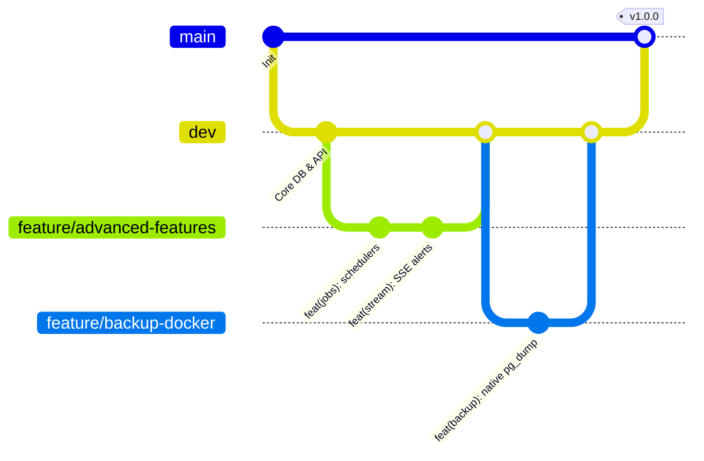

# Contributing to AssetVault

Thank you for your interest in contributing to **AssetVault: Multi-Tenant Digital Asset & License Management System**. This repository adheres to strict engineering guidelines to maintain data integrity, security, and consistent version history.

---

## 1. Branching Strategy

Our branching workflow follows GitFlow best practices:

* **`main`**: Production-ready, fully tested, and deployable code. Direct commits to `main` are prohibited.
* **`dev`**: Primary integration branch where verified features converge before staging and production release.
* **`feature/*`**: Dedicated branches for scoped capabilities (e.g. `feature/auth`, `feature/assets-api`, `feature/backup-docker`).
* **`fix/*`**: Targeted bug fixes branched from `dev`.
* **`docs/*`**: Architectural and academic documentation updates.



---

## 2. Commit Message Standards (Conventional Commits)

We enforce the [Conventional Commits v1.0.0](https://www.conventionalcommits.org/) standard via `commitlint`. Commits must follow this format:

```text
<type>(<scope>): <short description in present tense>

[optional body describing technical decisions]

[optional footer(s)]
```

### Allowed Commit Types:
* **`feat`**: A new user-facing or architectural capability.
* **`fix`**: A bug fix.
* **`docs`**: Documentation changes only.
* **`style`**: Code formatting, missing semi-colons (no code logic changes).
* **`refactor`**: Code change that neither fixes a bug nor adds a feature.
* **`perf`**: A code change that improves execution performance.
* **`test`**: Adding missing tests or correcting existing tests.
* **`build`**: Changes that affect the build system or external dependencies.
* **`ci`**: Changes to CI configuration files and automation scripts.
* **`chore`**: Maintenance tasks, dependency bumps, or housekeeping.

### Example Commit:
```bash
git commit -m "feat(backup): implement native pg_dump and 7-day retention script"
```

---

## 3. Pre-Commit Hooks & Quality Gates

This repository uses **Husky** hooks to automatically enforce quality gates before commits are recorded:

1. **Secret Scanning (`pre-commit`):** Automatically scans staged files for accidentally exposed tokens, private keys, or `.env` files using `scripts/scan-secrets.js`.
2. **Commit Message Validation (`commit-msg`):** Validates format against Conventional Commits using `@commitlint/cli`.

To manually run verification checks before committing:
```bash
# 1. Type safety and linting
npm run lint

# 2. Secret hygiene scan
npm run check:secrets

# 3. Unit and service integration tests
npm run test

# 4. Playwright End-to-End browser journeys
npm run test:e2e
```

---

## 4. Pull Request Lifecycle

1. Fork or branch from `dev`.
2. Ensure all 4 verification commands pass locally.
3. Fill out `.github/pull_request_template.md` thoroughly.
4. Ensure the checklist is completed:
   - [ ] No secrets committed.
   - [ ] Tests passing at 100%.
   - [ ] Linting passing with 0 errors.
   - [ ] ER diagram updated if database schema was altered.
