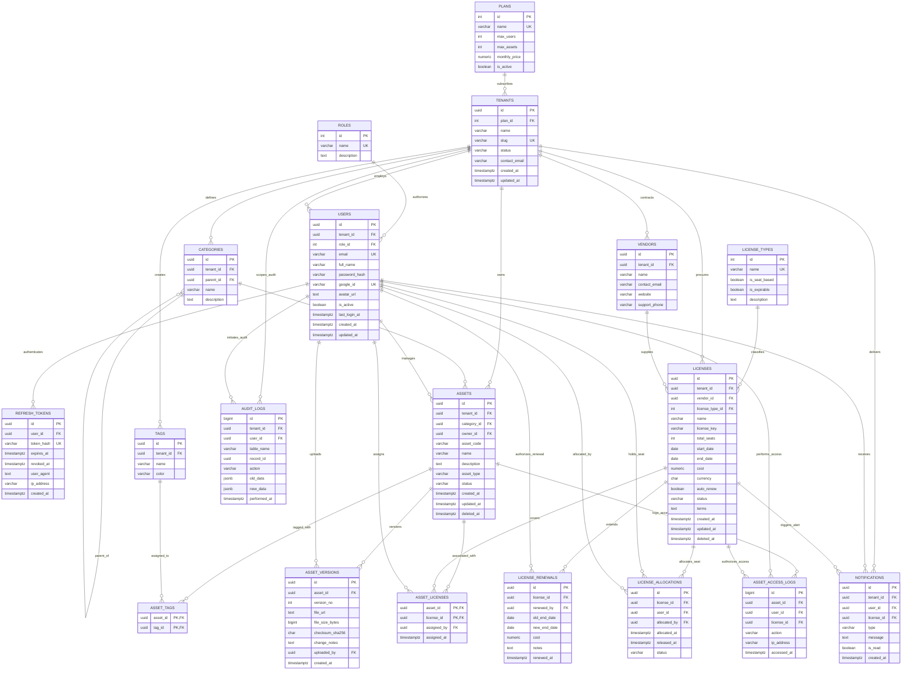

# AssetVault: Entity-Relationship (ER) Architecture

**Course:** BCSE307L – Database Systems (Fall Semester 2026–27)  
**Institution:** School of Computer Science and Engineering (SCOPE), Vellore Institute of Technology (VIT), Vellore  
**System:** AssetVault (Multi-Tenant Digital Asset & License Management System)  
**Database Engine:** PostgreSQL 16  

---

## 1. Executive Summary & Primary Entities

AssetVault is structured around five primary business pillars that govern tenant operations, identity lifecycle, digital asset versioning, and compliance enforcement:

1. **`tenants`:** The root organizational boundary for the multi-tenant SaaS. Every tenant is associated with a subscription plan (`plans`) and logically owns users, vendors, categories, tags, assets, licenses, audit logs, and notifications.
2. **`users`:** Unified identity repository across all organizations and administrative tiers. Accommodates Super Administrators (global scope, `tenant_id` is `NULL`) and tenant-scoped actors (Tenant Admin, Asset Manager, Member). Supports both Google OAuth 2.0 federation and bcrypt-hashed local credentials.
3. **`assets`:** Core digital asset repository cataloging proprietary fonts, datasets, design media, and software binaries. Carries categorized taxonomies, version history (`asset_versions`), and tag associations (`asset_tags`).
4. **`licenses`:** Enterprise software and digital rights agreements issued by commercial vendors. Manages seat capacity constraints, contractual validity horizons, renewal history (`license_renewals`), and multi-asset coverage associations (`asset_licenses`).
5. **`vendors`:** Software publishers and content providers (e.g., Adobe, JetBrains, Microsoft) holding supply contracts with individual tenants.

### Key Relationships Overview
- **Tenancy Scoping (1:N):** `tenants` strictly scopes top-level tables (`users`, `vendors`, `categories`, `assets`, `tags`, `licenses`, `audit_logs`, `notifications`). All child entities (`asset_versions`, `asset_tags`, `asset_licenses`, `license_allocations`, `asset_access_logs`, `license_renewals`) inherit tenancy through their parent relationships without redundant foreign keys, eliminating transitive dependencies and strictly maintaining 3NF.
- **Many-to-Many Resolvers (M:N):**
  - `asset_tags`: Associates digital assets with dynamic metadata tags (`assets` M:N `tags`).
  - `asset_licenses`: Resolves asset coverage where one asset can require multiple licenses and a site license covers multiple assets (`assets` M:N `licenses`).
  - `license_allocations`: Resolves seat entitlement where one license allocates seats to multiple users, and one user can hold multiple license seats (`licenses` M:N `users`), enriched with allocation timestamps and status tracking.
- **Hierarchical Self-Reference (1:N):** `categories.parent_id` references `categories.id` allowing arbitrary tree taxonomies for asset classification within each tenant.

---

## 2. Mermaid ER Diagram (Crow's-Foot Notation)

---

## 3. Diagram Notation & Legend

| Symbol | Notation Meaning | Cardinality Semantics |
| :---: | :--- | :--- |
| `||--o{` | One to Zero-or-Many | The parent entity must exist; the child entity can have 0, 1, or many rows. |
| `||--|{` | One to One-or-Many | Mandatory parent relationship with at least one corresponding child record. |
| `PK` | Primary Key | Unique, non-null identifier for the relation. Uses UUIDv4 or SERIAL integer. |
| `FK` | Foreign Key | Referential constraint enforcing referential integrity back to parent relation. |
| `UK` | Unique Key | Unique constraint enforcing column or composite business exclusivity. |

### Visual Diagram File
The rendered vector architecture diagram is exported and maintained as [`er-diagram.svg`](./er-diagram.svg).
