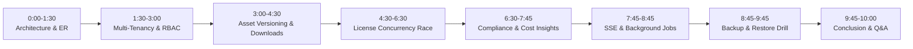

# AssetVault - 10-Minute Viva Presentation & Live Demo Script
**Course:** BCSE307L Database Systems (Fall 2026-27)  
**Target Duration:** Exactly 10 Minutes  
**Target Audience:** Demanding Course Examiners & Technical Evaluators  
**System Prerequisites:** Docker containers or local dev servers running (`npm run dev`), browser open at `http://localhost:5173`.  

---

## Demo Credentials Quick Reference
| Organization / Tenant | Role | Email | Password |
| :--- | :--- | :--- | :--- |
| **System Operator** | `SUPER_ADMIN` | `superadmin@assetvault.io` | `Password123!` |
| **TechCorp Solutions (Tenant A)** | `TENANT_ADMIN` | `techcorp.admin@techcorp.io` | `Password123!` |
| **TechCorp Solutions (Tenant A)** | `ASSET_MANAGER`| `techcorp.mgr1@techcorp.io`| `Password123!` |
| **TechCorp Solutions (Tenant A)** | `MEMBER` | `techcorp.dev1@techcorp.io` | `Password123!` |
| **InnovateLabs (Tenant B)** | `TENANT_ADMIN` | `innovatelabs.admin@innovatelabs.io`| `Password123!` |

*(Note: The login page includes 1-click demo credential pills for instant auto-fill).*

---

## Chronological Demo Flowchart (10 Minutes)



---

## Detailed Step-by-Step Cue Cards

### Minute 0:00 – 1:30 | Introduction & Architectural Rigor
- **What to say:**
  > "Good morning, respected examiners. Today I am presenting **AssetVault**, an enterprise multi-tenant digital asset and software license management platform. While many student projects are simple CRUD wrappers, AssetVault was architected from the database kernel up on PostgreSQL 16. It handles 19 normalized domain tables in BCNF, enforces dual-layer tenant isolation, and uses stored procedures with row-level locks to solve multi-threaded seat allocation races."
- **What to show on screen:**
  - Show the ER Diagram in [`database/er-diagram.md`](../database/er-diagram.md).
  - Point to the 19 domain tables, 34 foreign keys, and 11 check constraints.
  - Explain the 3NF/BCNF factoring: `plans` factored out of `tenants`, `license_types` factored out of `licenses`, and `roles` factored out of `users`.

---

### Minute 1:30 – 3:00 | Multi-Tenancy & Strict RBAC
- **What to do:**
  1. Open browser at `http://localhost:5173/login`.
  2. Click the quick-fill button for **TechCorp Admin** (`techcorp.admin@techcorp.io`). Click **Sign In**.
  3. Show the dashboard: Notice the organization header reads **"TechCorp Solutions"**.
  4. Open an Incognito window (or second browser profile) at `http://localhost:5173/login`.
  5. Sign in as **InnovateLabs Admin** (`innovatelabs.admin@innovatelabs.io`).
- **What to say:**
  > "Notice that TechCorp and InnovateLabs share the exact same physical database and schema. However, our custom Prisma client extension and PostgreSQL session variables enforce dual-layer isolation. If a user in TechCorp tries to query an InnovateLabs asset ID directly via the API, the system returns `404 Not Found` rather than `403 Forbidden`, deliberately preventing resource enumeration attacks."
- **Technical Highlight to mention:**
  - "There is strictly **ONE `users` table** with a `role_id` foreign key. There are no anti-pattern separate tables like `admin_users` or `student_users`."

---

### Minute 3:00 – 4:30 | Digital Asset Lifecycle & Versioning
- **What to do:**
  1. In TechCorp Admin window, navigate to **Assets** (`/assets`).
  2. Click **Create Asset**. Fill in:
     - Name: `Figma Enterprise UI Kit 2026`
     - Asset Type: `DOCUMENT`
     - Category: Select `Design Assets`
     - Status: `ACTIVE`
  3. Click **Submit**. Show that it appears immediately in the catalog.
  4. Click on the asset to view its detail drawer.
  5. Point out **Version Control**: Click **Upload New Version** (creates Version 2.0).
  6. Click **Download Asset**: Notice the real-time access log entry created in `asset_access_logs`.
- **What to say:**
  > "Every asset is versioned with SHA-256 integrity hashes and file size validation enforced by PostgreSQL check constraint `chk_asset_versions_size_positive`. Accesses and checkouts are logged with timestamps and user references."

---

### Minute 4:30 – 6:30 | Software License Management & Concurrency Checkout Race
- **What to do:**
  1. Navigate to **Licenses** (`/licenses`).
  2. Point out the license list: Total Seats, Used Seats, Expiration Date, and Status.
  3. Open a terminal side-by-side with the browser.
  4. Run the automated concurrency test:
     ```bash
     npm test -- break-it-security.test.ts
     ```
  5. Show the terminal output highlighting:
     ```
     Raw query failed. Code: 23514. Message: ERROR: License seats exhausted
     ✓ fires 20 concurrent allocation requests at a 3-seat license: exactly 3 succeed, 17 blocked
     ```
- **What to say:**
  > "This is our proudest database engineering feature. In standard web applications, concurrent requests read the seat count simultaneously, causing over-allocation. We solved this inside the database using PostgreSQL Stored Procedure `sp_allocate_license_seat`. It executes a `SELECT ... FOR UPDATE` row-level lock on the license record. Under a burst of 20 simultaneous threads competing for 3 seats, exactly 3 succeed and 17 are cleanly rejected by PostgreSQL error code 23514. The database mathematically prevents over-allocation."

---

### Minute 6:30 – 7:45 | Compliance Engine & Cost Optimization Insights
- **What to do:**
  1. Return to the **Dashboard** (`/dashboard`).
  2. Point out the interactive **Compliance Score Gauge** (e.g. 85/100).
  3. Click the drill-down button: Explain the four weighted factors:
     - Share of assets with valid license coverage ($+40\%$)
     - Zero over-allocation violations ($+30\%$)
     - No expired licenses bound to active assets ($+15\%$)
     - Proactive renewal planning ($+15\%$)
  4. Scroll to the **Unused Seats Cost Optimization** card.
  5. Point out an allocation with $>30$ days of inactivity showing:
     - User Name, License, Inactive Days, and Potential Monthly Savings (e.g., `\$75.00/mo`).
  6. Click the **Release Seat** button: Show that `sp_release_license_seat` is invoked, immediately freeing the seat and recalculating savings.
- **What to say:**
  > "AssetVault doesn't just store data; it provides actionable business intelligence. Our compliance algorithm and unused-seats engine directly save enterprise dollars by detecting zombie seats."

---

### Minute 7:45 – 8:45 | Background Worker & Real-Time SSE Notifications
- **What to do:**
  1. Point to the **Notification Bell** in the top navigation bar.
  2. Show that real-time notifications are delivered via Server-Sent Events (`GET /api/notifications/stream`) without continuous polling.
  3. Briefly open `backend/src/worker.ts` in the editor.
- **What to say:**
  > "For background tasks, we built a dedicated worker in `backend/src/worker.ts`. It runs node-cron jobs that check for expiring licenses daily at 02:00, auto-renew licenses where `auto_renew = true`, and refresh our materialized view `mv_monthly_access_stats`. To guarantee safety in multi-instance cloud deployments, every job acquires a PostgreSQL advisory lock (`pg_try_advisory_lock`), ensuring no duplicate work occurs."

---

### Minute 8:45 – 9:45 | Native Database Backup & Recovery Drill
- **What to do:**
  1. Open terminal and run:
     ```bash
     npm run db:backup
     ```
  2. Show the output: Custom dump format `-Fc`, plain SQL dump `-Fp`, and `.sha256` checksum.
  3. Run the verification script:
     ```bash
     npm run db:verify-restore
     ```
  4. Show the printed PASS/FAIL table showing 100% row match between source and scratch databases.
- **What to say:**
  > "We do not rely on third-party black-box tools. We wrote native PostgreSQL backup and recovery scripts with SHA-256 checksum validation, 7-day retention rotation, and automated scratch-database verification. Our recovery drill in `docs/backup-recovery.md` proves that even if data is deleted, it is completely restorable."

---

### Minute 9:45 – 10:00 | Conclusion & Q&A Transition
- **What to say:**
  > "In summary: AssetVault delivers 19 BCNF-normalized tables, dual-layer multi-tenant isolation, row-locked concurrency safety, automated background jobs with advisory locks, real-time SSE alerts, and 126 passing automated tests across 6 test suites. Thank you, and I look forward to your questions."

---

## Contingency / Backup Plans During Viva
1. **Network Disconnection:** All services (PostgreSQL, Express API, Vite SPA) run locally on `localhost`. No external internet is required.
2. **Database Reset Needed:** Run `npm run db:seed` in terminal; the seed script resets all demo data in $<3$ seconds.
3. **Examiner Asks to Inspect Raw SQL:** Open `docs/FINAL_AUDIT.md` Section 3; every raw query is indexed with its exact examiner justification.
