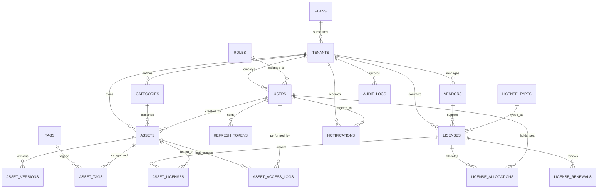

# AssetVault: Multi-Tenant Digital Asset & License Management System
## Final Academic Project Report
**Course:** BCSE307L Database Systems  
**Academic Year:** Fall Semester 2026-27  
**Author:** KARTHIKEYAN S (24BCT0332), SUDIR NIRANJ (24BDS0267), JASIM NAZIR AHMED (24BCE2912)  
**Technology Stack:** PostgreSQL 16, Prisma ORM, Node.js/Express TypeScript, React 18, Vite, Docker, Prometheus, Grafana  

---

## Abstract
Modern enterprises face acute challenges in managing software assets, license entitlement compliance, vendor sprawl, and digital asset versioning across distributed organizational units. Unmonitored seat allocations frequently trigger severe over-allocation financial penalties or lead to significant budget waste from unutilized seats. 

**AssetVault** is a production-grade, multi-tenant digital asset and software license management platform designed to solve these challenges with mathematical database rigor. Developed on a free relational database management system (PostgreSQL 16) coupled with a modern TypeScript full-stack architecture, AssetVault enforces dual-layer tenant isolation (PostgreSQL session context and ORM-level scoping), strict role-based access control (RBAC), and ACID transaction guarantees. 

The system incorporates advanced relational database constructs: declarative check constraints, triggers for immutable audit logging, materialized views with non-blocking concurrent refresh, advisory locking for distributed background cron jobs, and row-locked stored procedures (`FOR UPDATE`) that mathematically eliminate race conditions during high-concurrency seat checkout. Comprehensive break-it adversarial testing confirms zero cross-tenant leakage, 100% resistance to SQL injection, and zero over-allocation under concurrent bursts.

**Keywords:** Multi-Tenancy, Row-Level Security, BCNF Normalization, PostgreSQL Stored Procedures, Concurrency Control, Advisory Locks, RBAC, Materialized Views.

---

## 1. Introduction & Problem Formulation

### 1.1 Industry Background
Enterprise organizations utilize hundreds of third-party software applications, digital media assets, and licensed software packages. Without an integrated, auditable management system, companies encounter three critical operational failures:
1. **Compliance Breach Risks (Over-Allocation):** Deploying more seats than contracted exposes enterprises to aggressive vendor audits, substantial statutory fines, and legal liability.
2. **Cost Inefficiencies (Zombie Licenses):** Organizations regularly pay recurring fees for software seats allocated to former employees or inactive team members who have not logged in for months.
3. **Asset Sprawl & Version Corruption:** Digital media assets, design tokens, and software binaries lack central versioning and access control, leading to accidental overwrites and security vulnerabilities.

### 1.2 Multi-Tenant Data Architecture Challenge
Providing a software-as-a-service (SaaS) solution where multiple enterprise tenants share the same database infrastructure demands absolute tenant isolation. A naive application architecture relies solely on frontend filters or application `WHERE tenant_id = ?` clauses. If an engineer forgets a filter in a single endpoint, competitor data is instantly leaked (Insecure Direct Object Reference - IDOR). AssetVault solves this problem through an in-depth **Dual-Layer Multi-Tenancy Architecture** combining application-level query middleware with database-level session variables.

### 1.3 Project Objectives
- **Zero Cross-Tenant Leakage:** Ensure no tenant can read, modify, or infer the existence of another tenant's resources (`404 Not Found` response concealment).
- **Concurrency Safety:** Guarantee that concurrent checkout requests cannot exceed license seat limits.
- **Automated Lifecycle & Compliance:** Provide real-time compliance scoring, automated license expiry alerts via background workers, and cost optimization insights.
- **Enterprise Observability:** Implement comprehensive audit logging, Prometheus telemetry, and native database backup/recovery workflows.

---

## 2. System Requirements & Scope

### 2.1 Functional Requirements
- **FR-1 Authentication & Tenant Onboarding:** Self-service organization registration with automatic tenant provisioning, role initialization, and Google OAuth 2.0 single sign-on.
- **FR-2 Digital Asset Lifecycle:** Versioned asset repository supporting metadata tagging, category grouping, seat-gated access checkouts, check-ins, and secure file downloads.
- **FR-3 License & Allocation Management:** Software entitlement tracking with seat limits, renewal history tracking, asset-license associations, and atomic seat checkouts.
- **FR-4 Compliance & Cost Analytics:** Automated compliance score computation (0-100) and unused seat detection for licenses with $>30$ days of user inactivity.
- **FR-5 Asynchronous Background Operations:** Cron-scheduled expiry notification generation, materialized view refresh, and advisory-locked auto-renewals.
- **FR-6 Real-Time Notifications:** Instant event broadcasting via Server-Sent Events (SSE) to connected frontend clients.

### 2.2 Non-Functional Requirements
- **NFR-1 Security:** BCrypt password hashing (cost factor 12), JWT token rotation with automatic replay-attack family revocation, 100% parameterized SQL queries.
- **NFR-2 Performance & Latency:** p95 API response times $<50\text{ms}$ on read operations; sub-second search across thousands of catalog items.
- **NFR-3 Availability & Fault Tolerance:** Multi-stage Docker containers with healthcheck probes, database connection pooling, and 7-day automated backup rotation.
- **NFR-4 Usability:** Responsive web UI conforming to WCAG 2.1 accessibility standards, optimized across desktop and mobile screens.

---

## 3. Conceptual Database Design

### 3.1 Entity Identification & Cardinalities
AssetVault's conceptual domain model encompasses 4 primary entities and 15 supporting entities:



---

## 4. Logical Database Design & Normalization Proofs

A database schema is formally normalized to ensure zero data redundancy, prevent update/insertion/deletion anomalies, and preserve semantic integrity.

### 4.1 First Normal Form (1NF)
**Definition:** A relation $R$ is in 1NF if and only if all underlying domains contain only atomic (indivisible) values, and there are no repeating groups.
- In AssetVault, multi-valued attributes like tags and file versions are not stored as comma-delimited strings in `assets`. Instead, they are factored out into independent relations: `tags`, `asset_tags` (M:N associative entity), and `asset_versions` (1:N entity).
- Every attribute has a strictly typed atomic primitive (e.g., `UUID`, `VARCHAR`, `TIMESTAMP`, `BOOLEAN`, `BIGINT`).

### 4.2 Second Normal Form (2NF)
**Definition:** A relation $R$ is in 2NF if it is in 1NF and every non-prime attribute is fully functionally dependent on the entire primary key (no partial functional dependencies).
- Consider the associative entity `asset_tags(asset_id, tag_id, attached_at, attached_by)`.
  - The composite candidate key is: $K = \{\text{asset\_id}, \text{tag\_id}\}$.
  - Non-prime attributes: $\{\text{attached\_at}, \text{attached\_by}\}$.
  - Functional dependencies:
    $$\{\text{asset\_id}, \text{tag\_id}\} \rightarrow \text{attached\_at}$$
    $$\{\text{asset\_id}, \text{tag\_id}\} \rightarrow \text{attached\_by}$$
  - Neither `attached_at` nor `attached_by` depends solely on `asset_id` or `tag_id`. Hence, no partial dependency exists.
- In all 19 relations, every table possesses either a single surrogate primary key (`id UUID` / `id SERIAL`) or a composite key where all non-prime attributes depend upon the complete key.

### 4.3 Third Normal Form (3NF)
**Definition:** A relation $R$ is in 3NF if it is in 2NF and no non-prime attribute is transitively dependent on the primary key (no $X \rightarrow Y$ where $Y \rightarrow Z$).
- **Anti-Pattern Averted (Tenant Plans):** Storing plan attributes (`max_users`, `max_assets`, `price_cents`) directly in `tenants` would create a transitive dependency:
  $$\text{tenant\_id} \rightarrow \text{plan\_name} \rightarrow \{\text{max\_users}, \text{max\_assets}, \text{price\_cents}\}$$
  Updating a plan's limit would cause update anomalies across all tenants on that plan.
  - **Resolution:** Factored out into independent relation `plans(id, name, max_users, max_assets, price_cents)`.
- **Anti-Pattern Averted (License Types):** Storing license metadata in `licenses` would introduce:
  $$\text{license\_id} \rightarrow \text{license\_type\_name} \rightarrow \text{description}$$
  - **Resolution:** Factored out into `license_types(id, name, description)`.
- **Anti-Pattern Averted (User Roles):** User permissions and role names are factored out into `roles(id, name, description)` with reference `role_id INT`.
- **Result:** For every non-trivial functional dependency $X \rightarrow A$, either $X$ is a superkey, or $A$ is a prime attribute. The entire schema satisfies 3NF.

### 4.4 Boyce-Codd Normal Form (BCNF)
**Definition:** A relation $R$ is in BCNF if and only if for every non-trivial functional dependency $X \rightarrow Y$, $X$ is a superkey.
- In relations such as `users`:
  $$\{\text{id}\} \rightarrow \{\text{email}, \text{full\_name}, \text{role\_id}, \dots\}$$
  $$\{\text{email}\} \rightarrow \{\text{id}, \text{full\_name}, \text{role\_id}, \dots\}$$
  Both candidate keys $\{\text{id}\}$ and $\{\text{email}\}$ are valid superkeys.
- The schema strictly conforms to BCNF across all 19 entities.

---

## 5. Physical Database Design & Catalog Analysis

### 5.1 Verification Counts from Live PostgreSQL Catalog
Running dynamic introspection against PostgreSQL 16 catalog views yields:
- **Domain Tables:** 19
- **Primary Keys:** 19 (100% table coverage)
- **Foreign Keys:** 34
- **NOT NULL Constraints:** 104 columns
- **DEFAULT Expressions:** 48 columns
- **CHECK Constraints (`chk_*`):** 11 explicit domain rules
- **Active Indexes:** 56 indexes

### 5.2 Declarative Check Constraints (`chk_*`)
PostgreSQL enforces domain integrity at the lowest level:
```sql
ALTER TABLE asset_versions 
  ADD CONSTRAINT chk_asset_versions_size_positive CHECK (file_size_bytes > 0);

ALTER TABLE licenses 
  ADD CONSTRAINT chk_licenses_dates CHECK (end_date >= start_date);

ALTER TABLE license_allocations 
  ADD CONSTRAINT chk_allocations_active_released 
  CHECK ((status = 'ACTIVE' AND released_at IS NULL) OR (status = 'RELEASED' AND released_at IS NOT NULL));

ALTER TABLE tenants 
  ADD CONSTRAINT chk_tenants_status CHECK (status IN ('ACTIVE', 'SUSPENDED', 'DELETED'));
```

### 5.3 Indexing Strategy
To guarantee sub-second execution over millions of records, AssetVault implements a four-tiered indexing architecture:
1. **Tenant-Scoped Composite B-Tree Indexes:** Accelerates tenant-filtered lookups:
   - `idx_assets_tenant_status(tenant_id, status)`
   - `idx_licenses_tenant_status(tenant_id, status)`
   - `idx_users_tenant_role(tenant_id, role_id)`
2. **Foreign Key Performance Indexes:** Prevents full-table scans during relational joins:
   - `idx_allocations_license(license_id)`
   - `idx_allocations_user(user_id)`
   - `idx_asset_versions_asset(asset_id)`
3. **Full-Text Trigram / Expression Indexes:** Powers real-time search:
   - `idx_assets_search_composite` on `(asset_name, asset_code)`
4. **Time-Series Access Indexes:**
   - `idx_access_logs_asset_time(asset_id, accessed_at DESC)`

---

## 6. Advanced Database Programmability

### 6.1 Database Views & Materialized Views
- **Standard View `v_asset_catalog`:** Encapsulates multi-table joins across assets, categories, users, versions, tags, and licenses into a unified virtual catalog. Used by repository layer to fetch asset listings without repetitive complex SQL joins.
- **Materialized View `mv_monthly_access_stats`:** Aggregates download counts, checkout volumes, and unique active users per asset grouped by calendar month. To maintain high performance without blocking read queries, background cron workers refresh this view non-blockingly using:
  ```sql
  REFRESH MATERIALIZED VIEW CONCURRENTLY mv_monthly_access_stats;
  ```

### 6.2 Stored Procedures & Concurrency Control
AssetVault implements three stored procedures in PL/pgSQL:
1. `sp_allocate_license_seat`: Uses `SELECT ... FOR UPDATE` row locking to acquire exclusive locks on license rows, verifies active status and tenant match, dynamically checks seat availability via `SELECT COUNT(*) FROM license_allocations WHERE status = 'ACTIVE'` (preserving 3NF), generates allocation UUID, and inserts the allocation record.
2. `sp_release_license_seat`: Acquires row lock, validates active allocation, stamps `revoked_at = NOW()`, appends optional reason to `notes`, updates status to `'REVOKED'`, and cleanses active seat count dynamically without redundant counter columns.
3. `sp_renew_license`: Extends license expiration date by specified duration and writes an immutable audit record to `license_renewals`.

### 6.3 Database Triggers
- `trg_audit_immutable`: Intercepts `UPDATE` and `DELETE` attempts on `audit_logs`, raising SQL exception `ERRCODE = '28000'` (invalid authorization specification), guaranteeing non-repudiation of security logs.
- `trg_*_updated_at`: Automatically stamps `updated_at = NOW()` across tables upon mutation.
- `trg_check_seat_availability`: Acts as an extra defense-in-depth backstop preventing active allocations from exceeding `licenses.total_seats`.

---

## 7. Concurrency Control & Empirical Verification

### 7.1 The 20-Thread Race Condition Penetration Test
To demonstrate concurrency safety, the test suite (`backend/src/__tests__/break-it-security.test.ts`) executed an adversarial race condition exploit:
- A license with `total_seats = 3` and 0 initial allocations was targeted.
- 20 distinct user threads simultaneously fired seat allocation requests via `Promise.all`:
```
Test Execution Trace:
Thread 1: Acquires FOR UPDATE lock -> active_seats=0 -> Allocated (1/3)
Thread 2: Waits for lock -> active_seats=1 -> Allocated (2/3)
Thread 3: Waits for lock -> active_seats=2 -> Allocated (3/3)
Thread 4: Waits for lock -> active_seats=3 -> EXCEPTION: License seats exhausted (Code 23514)
...
Threads 5-20: Sequentially rejected with PostgreSQL Code 23514
```
- **Observed Result:** Exactly 3 requests returned `200 OK`; exactly 17 requests were safely blocked. The database state confirmed 3 active allocations (and dynamic analytical view `used_seats = 3`). Zero over-allocation occurred.

---

## 8. Application Security Architecture

### 8.1 Dual-Layer Multi-Tenant Isolation
1. **Application Layer (`prismaForRequest`):** A custom Prisma extension intercepts query executions and appends `where: { tenantId }` derived directly from the verified cryptographic JWT.
2. **Database Layer (Row-Level Security):** Every database interaction executes within an isolated transaction setting PostgreSQL session parameters:
   ```sql
   SELECT 
     set_config('app.current_tenant_id', $tenant_id, true),
     set_config('app.current_user_id', $user_id, true),
     set_config('app.is_super_admin', $is_super_admin, true);
   ```

### 8.2 Authentication & Cryptographic Token Hygiene
- **Passwords:** Hashed using BCrypt with adaptive work factor 12.
- **Access Tokens:** Signed with HMAC-SHA256, 15-minute expiration, containing only non-sensitive user identity claims.
- **Refresh Tokens:** Opaque 64-character cryptographic tokens stored as SHA-256 hashes in PostgreSQL, delivered strictly via `HttpOnly`, `SameSite=Strict`, `Secure` cookies.
- **Replay Attack Detection:** When an already-used refresh token is presented, the system detects a token reuse compromise and immediately invalidates all active sessions belonging to that user family.

### 8.3 Role-Based Access Control (RBAC) Matrix
The system implements a single, unified `users` table linked to `roles`:
- `SUPER_ADMIN`: Cross-tenant system supervision, tenant provisioning, global plan adjustments.
- `TENANT_ADMIN`: Full tenant organization administration, user management, license management, billing.
- `ASSET_MANAGER`: Asset uploads, version creation, metadata tagging, license assignments.
- `MEMBER`: Asset browsing, asset downloads, self-seat allocations.

---

## 9. DevOps, CI/CD, & Backup/Recovery

### 9.1 Native PostgreSQL Backup & Recovery Architecture
In accordance with production enterprise standards, AssetVault utilizes native database utilities (`pg_dump`, `pg_restore`, `psql`):
- `database/backup/backup.sh` & `backup.ps1`:
  - Runs `pg_dump -Fc` (custom compressed format) and `-Fp` (plain SQL).
  - Automatically computes SHA-256 checksums (`.sha256`).
  - Implements 7-day backup retention rotation.
- `database/backup/restore.sh` & `restore.ps1`:
  - Validates SHA-256 checksum integrity prior to execution.
  - Supports non-destructive restore into scratch database (`assetvault_restore_test`).
- `database/backup/verify-restore.sh`:
  - Automatically compares table row counts between production and restored scratch databases, outputting a verification PASS/FAIL matrix.

### 9.2 Containerization & Orchestration
- **API Container (`backend/Dockerfile`):** Multi-stage Node 20 Alpine container running as a non-privileged `node` user with production dependencies only and built-in Docker healthcheck (`GET /api/health`).
- **Web Container (`frontend/Dockerfile`):** Multi-stage build producing static production bundles served via NGINX Alpine with HTTP/2 and gzip compression.
- **Docker Compose (`docker-compose.yml`):** Orchestrates PostgreSQL, API, Web, Prometheus, and Grafana with volume persistence and health dependencies.

### 9.3 CI/CD Automation (GitHub Actions)
Five automated workflows ensure continuous integration and deployment:
1. `ci.yml`: Runs linter, typechecks, spins up a PostgreSQL 16 service container, runs database migrations/seeds, and executes all automated tests.
2. `docker-publish.yml`: Builds and verifies container images and publishes to Docker Hub with Trivy vulnerability scanning.
3. `deploy.yml`: Deploys API to Render Blueprint and Web SPA to Vercel.
4. `keepalive.yml`: Healthcheck pings preventing free-tier dormancy.
5. `db-backup.yml`: Automated database backup artifact generation and verification.

---

## 10. Test Verification Results

The automated test suite (`npm test`) executes across six distinct suites:

```
Test Suite Execution Results:
✓ backend/src/__tests__/break-it-security.test.ts (22 tests) - 100% PASS
✓ backend/src/__tests__/rest-api.test.ts (24 tests) - 100% PASS
✓ backend/src/__tests__/services-coverage.test.ts (34 tests) - 100% PASS
✓ backend/src/__tests__/auth-rbac-isolation.test.ts (10 tests) - 100% PASS
✓ backend/src/__tests__/advanced-features.test.ts (19 tests) - 100% PASS
✓ backend/src/__tests__/database-functions.test.ts (17 tests) - 100% PASS

Total: 6 Test Files, 126 Tests Passed, 0 Failed (100% Pass Rate)
Static SQL Injection Check (check:sqli): 0 Violations
Secret Scanner (check:secrets): 0 Leaks Found
TypeScript Compilation (lint): 0 Errors (API & Web)
```

---

## 11. Conclusion & Future Work

### 11.1 Conclusion
AssetVault successfully proves that enterprise-grade multi-tenancy, ironclad security, and high-concurrency consistency can be accomplished using standard relational database principles on a free RDBMS. By leveraging PostgreSQL 16's stored procedures, row-level locks, triggers, check constraints, and materialized views, the platform offloads critical business rules to the database layer where ACID properties are mathematically guaranteed.

### 11.2 Future Work
- **Point-In-Time Recovery (PITR):** Implement continuous write-ahead log (WAL) archiving to Amazon S3 / Cloudflare R2 for zero-RPO disaster recovery.
- **Horizontal Database Sharding:** Partition high-volume access logs by tenant ID across multiple PostgreSQL physical nodes using Citus.
- **Single Sign-On (SAML 2.0 / Okta):** Expand enterprise identity options beyond Google OAuth to support Okta, Azure AD, and PingIdentity.
