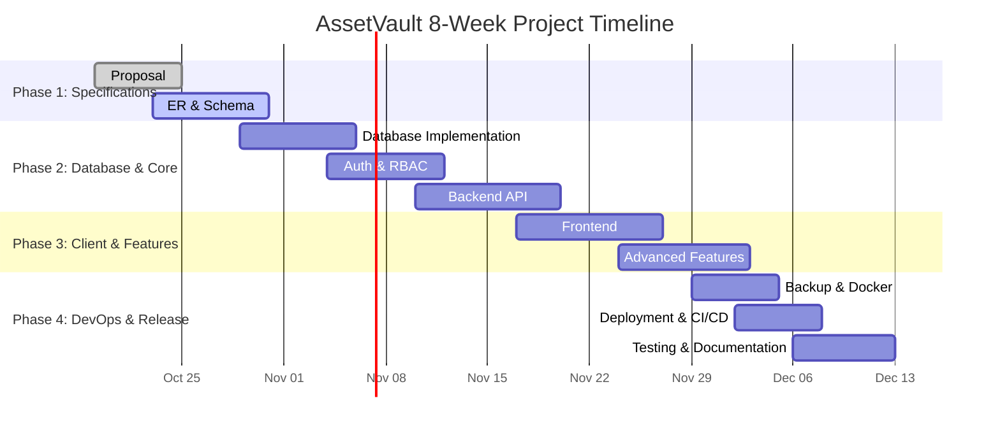

# 1. Project Title

**AssetVault: A Multi-Tenant Digital Asset & License Management System**

- **Course:** BCSE307L – Database Systems (Fall Semester 2026–27)  
- **Institution:** School of Computer Science and Engineering (SCOPE), Vellore Institute of Technology (VIT), Vellore  
- **Document Version:** 1.0.0  
- **Date of Submission:** October 19, 2026  

---

# 2. Problem Statement

Modern technology, design, and media enterprises manage extensive inventories of high-value digital assets—including proprietary typefaces, high-resolution media, machine learning training corpora, and compiled software binaries—alongside costly commercial software licenses from vendors such as Adobe, JetBrains, Microsoft, and Autodesk. In practice, organizations frequently attempt to track these assets, contracts, and seat allocations using decentralized spreadsheets, disconnected emails, and shared network drives. This ad-hoc approach creates severe operational friction: software licenses expire unnoticed, leading to unplanned service disruptions, while "zombie" recurring subscriptions go undetected, draining departmental budgets. Furthermore, organizations routinely exceed their contracted license seat capacities without knowing it, leaving them vulnerable to severe financial penalties and legal liability during vendor audits.

The challenge escalates dramatically in a Software-as-a-Service (SaaS) multi-tenant architecture where multiple independent client organizations share common computing and database infrastructure. In this environment, tenant isolation is not merely an architectural preference—it is a mandatory legal and regulatory requirement. A defect in access control or query scoping can inadvertently expose proprietary digital assets, internal staff directory allocations, and confidential licensing contracts to competing client organizations. Traditional spreadsheet-based workflows and loosely structured NoSQL document stores fail to provide the deterministic multi-tenancy guarantees, transactional integrity, and mathematical proof of isolation demanded by enterprise clients.

A relational database management system (PostgreSQL 16) provides the definitive solution to these systemic failures. Relational normalization guarantees that redundant vendor, contract, asset, and user data are eliminated across all entities, completely preventing update, insertion, and deletion anomalies. Declarative integrity constraints—including primary keys, foreign keys, domain `CHECK` constraints, and unique indexes—enforce business boundaries at the storage layer. Critical business logic, such as preventing seat over-allocation and generating multi-horizon expiration notifications, is enforced transactionally through database triggers and PL/pgSQL stored procedures, eliminating concurrency race conditions. Concurrently, native PostgreSQL Row-Level Security (RLS), combined with immutable JSONB audit logging and targeted B-tree and GIN indexing, guarantees absolute cross-tenant isolation, tamper-proof compliance trails, and sub-100 millisecond analytical query execution.

---

# 3. Objectives

The primary engineering and database objectives of AssetVault are:

1. **Absolute Multi-Tenant Data Isolation:** Enforce complete logical separation across all tenant organizations at both the database level using PostgreSQL Row-Level Security (RLS) policies and the application layer through automated tenant-scoping middleware.
2. **Normalized 3NF Relational Architecture:** Design, normalize, and implement a relational schema comprising 19 tables in Third Normal Form (3NF), eliminating transitive dependencies and update anomalies.
3. **Concurrency-Safe License Seat Bounds Enforcement:** Prevent license over-allocation at the database engine level via a PL/pgSQL trigger (`trg_check_seat_availability`) and a transactional stored procedure (`sp_allocate_license_seat`), guaranteeing that active allocations never exceed purchased capacity even under concurrent requests.
4. **Automated Multi-Horizon Expiry Alerts:** Implement automated database functions and scheduled routines that calculate and dispatch renewal notifications at 30, 15, and 7-day intervals prior to license expiration.
5. **Immutable Compliance Audit Trail:** Capture 100% of state-modifying operations (`CREATE`, `UPDATE`, `DELETE`, `ALLOCATE`, `REVOKE`) in an append-only audit log recording client IP addresses, actor user IDs, operation timestamps, and structured JSONB diffs of `old_values` versus `new_values`.
6. **High-Performance Query Execution:** Optimize all critical database query paths to achieve sub-100ms response times by deploying foreign key B-tree indexes, partial unique indexes for active seat allocations, and PostgreSQL GIN trigram indexes (`pg_trgm`) for fuzzy text searches across assets and tags.
7. **Enterprise Dual-Mode Authentication & RBAC:** Implement secure authentication featuring Google OAuth 2.0 (via Passport.js) and email/password login hashed with bcrypt (cost factor 12), coupled with a 4-tier Role-Based Access Control hierarchy (`SUPER_ADMIN`, `TENANT_ADMIN`, `ASSET_MANAGER`, `MEMBER`).
8. **Strictly Layered RESTful Backend API:** Develop a modular backend using Node.js 20+, Express.js, and TypeScript structured into Routes, Controllers, Services, and Repositories, with complete runtime input validation enforced via Zod schemas.
9. **Responsive Single-Page Application (SPA):** Construct a responsive web frontend utilizing React 18, Vite, TypeScript, and Tailwind CSS, featuring TanStack Query for client-side caching, optimistic UI updates, and real-time form validation.
10. **Containerization & Automated Disaster Recovery:** Provide a zero-dependency local deployment configuration via Docker and Docker Compose, alongside verified backup and restore scripts for PostgreSQL database dumps and point-in-time recovery.

---

# 4. Scope

### In Scope
- **Multi-Tenant Organization Management:** Tenant onboarding, profile configuration, custom branding slugs, and tenant-scoped operational settings.
- **Digital Asset Cataloging:** Ingestion of digital asset metadata (file names, MIME types, file sizes, cryptographic hashes, external resource URLs, categories, and tags).
- **Software License Lifecycle:** Comprehensive tracking of commercial software licenses supporting per-seat, site, perpetual, and subscription models.
- **Seat Allocation & Revocation Matrix:** Granting and revoking individual license seats to verified organization users with strict database trigger enforcement.
- **Vendor Relationship Management:** Recording vendor contacts, contract durations, customer support channels, and associated license agreements.
- **Analytical Reporting Views:** Pre-compiled SQL views for active asset licenses, tenant license utilization, and 30-day expiring license horizons.
- **Automated Expiration Alerting:** Proactive notification dispatch at 30, 15, and 7 days before license termination.
- **Regulatory Audit Trail:** Comprehensive JSONB state change capture for all data mutations across tenant assets and allocations.
- **Security & Session Governance:** 15-minute JWT access tokens and SHA-256 hashed refresh tokens stored in httpOnly, secure, sameSite cookies; Helmet HTTP headers; and express-rate-limit brute-force protection.
- **Disaster Recovery & Portability:** Automated database backup/restore scripts and containerized Docker execution.

### Out of Scope
- **Direct Binary Blob Hosting:** AssetVault stores asset metadata, cryptographic verification hashes, and secure external asset URLs; hosting raw multi-gigabyte binary files directly within PostgreSQL or on local disk is out of scope.
- **Real Monetary Payment Gateway Processing:** The system tracks subscription tiers, license pricing, and contract costs logically as financial metadata; direct credit card processing via Stripe or Razorpay is out of scope.
- **Native Mobile & Desktop Applications:** Development is focused strictly on a responsive, desktop- and tablet-optimized web application (React 18 SPA); native iOS/Android or desktop executable wrappers are out of scope.
- **Enterprise LDAP / Active Directory Federation:** Identity management standardizes on Google OAuth 2.0 and native email/password credentials; enterprise SAML 2.0 and on-premise LDAP synchronization are out of scope.

---

# 5. Team Members and Responsibilities

| Name | Register No. | Role | Responsibilities |
| :--- | :--- | :--- | :--- |
| `KARTHIKEYAN S` | `24BCT0332` | Database Architect & Backend Lead | Conceptual and logical ER modeling, relational 3NF normalization proofs, SQL DDL scripts, PL/pgSQL triggers, stored procedures, Row-Level Security policies, indexing strategy, Prisma ORM schema integration, and core backend REST API services (Asset, License, Seat Allocation). |
| `SUDIR NIRANJ` | `24BDS0267` | Frontend Architect & UI/UX Lead | React 18 + Vite SPA architecture, Tailwind CSS design system, responsive component engineering, TanStack Query caching and state synchronization, React Hook Form + Zod client validation, seat matrix user interface, and analytical reporting views. |
| `JASIM NAZIR AHMED` | `24BCE2912` | DevOps Engineer, Security & QA Lead | Authentication engine (Google OAuth 2.0, JWT, bcrypt), security middleware (Helmet, rate limiting, CORS), Docker Compose configuration, GitHub Actions CI/CD workflows, automated backup/restore scripts, end-to-end testing, and project documentation. |

---

# 6. Technology Stack

| Layer | Technology | Justification |
| :--- | :--- | :--- |
| **Database** | PostgreSQL 16 | Enterprise-grade relational DBMS providing full ACID compliance, Row-Level Security (RLS) for tenant isolation, PL/pgSQL procedural triggers, JSONB for immutable audit diffs, and GIN trigram indexing for high-speed text search. |
| **ORM / Data Access** | Prisma ORM 5.x | Type-safe query building, declarative schema modeling, migration versioning, and parameterized query execution preventing SQL injection vulnerabilities. Raw SQL (`$queryRaw`) is reserved strictly for custom views, triggers, and RLS. |
| **Backend API** | Node.js 20+ with Express.js & TypeScript | Non-blocking asynchronous I/O engine, modular layered architecture (Routes -> Controllers -> Services -> Repositories), strict compile-time type safety, and predictable RESTful endpoint structures. |
| **Validation & Security** | Zod, Helmet, Express Rate Limit, CORS | Strict runtime schema parsing of all incoming payloads and environment variables, defense-in-depth HTTP security headers, brute-force mitigation, and cross-origin resource isolation. |
| **Authentication** | Google OAuth 2.0 (Passport.js), BCrypt (cost 12), JWT | Dual-mode authentication: OAuth 2.0 identity federation alongside secure local credentials hashed with bcrypt. 15-minute short-lived access tokens and SHA-256 hashed refresh tokens stored in httpOnly, secure, sameSite cookies. |
| **Frontend Framework** | React 18 + Vite + TypeScript | High-performance single-page application (SPA) architecture, lightning-fast HMR and bundling via Vite, and strictly typed component props and state interfaces. |
| **Styling & Icons** | Tailwind CSS + Lucide React | Modern utility-first CSS framework ensuring responsive, tenant-brandable design systems with zero runtime overhead; accessible and modern icon suite. |
| **State & Forms** | TanStack Query v5 + React Hook Form | Declarative server-state caching, automatic background refetching, optimistic UI updates, and uncontrolled high-performance form state validation backed by Zod. |
| **Containerization & CI** | Docker, Docker Compose, GitHub Actions | Multi-stage container builds ensuring identical execution across development and production environments, automated test execution, and CI/CD validation. |
| **Cloud Hosting** | Supabase (PostgreSQL), Render (API), Vercel (Web) | Cloud-native multi-tier hosting: managed PostgreSQL 16 with direct connection pooling, serverless frontend CDN edge distribution, and continuous API deployment. |

---

# 7. Major Deliverables

1. **Entity-Relationship (ER) Diagram:** Complete Chen and Crow's Foot notation diagrams documenting all 19 entities, attributes, primary/foreign keys, and cardinality constraints ([`/database/er-diagram.md`](../database/er-diagram.md)).
2. **Relational Schema Specification & Normalization Proof:** Formal relational schemas with mathematical proofs demonstrating Third Normal Form (3NF) compliance and zero update/deletion anomalies ([`/database/normalization.md`](../database/normalization.md)).
3. **Comprehensive Data Dictionary:** Detailed attribute specifications covering table names, column descriptions, PostgreSQL data types, nullability, primary/foreign key relationships, default values, and index rationale ([`/database/data-dictionary.md`](../database/data-dictionary.md)).
4. **Complete SQL Script Suite:** Modular, executable PostgreSQL scripts located in [`/database/sql/`](../database/sql/):
   - `01_views.sql` (Analytical & reporting relational views, materialized views)
   - `02_functions_procedures.sql` (Stored procedures, capacity allocation, dashboard KPI functions)
   - `03_triggers.sql` (Automated audit logging, seat limit, and cross-tenant triggers)
   - `04_rls.sql` (Row-Level Security multi-tenant policies)
   - `05_queries.sql` (Complex multi-table queries, analytical aggregations)
   - `06_transactions_demo.sql` (Transaction isolation levels & concurrency demonstrations)
   - `08_production_bootstrap.sql` (Production schema initialization & database bootstrap)
5. **Layered Backend REST API:** Modular Express.js + TypeScript service ([`/backend`](../backend)) implementing strict layered architecture, Zod validation, centralized error handling, and complete CRUD endpoints for all business domains.
6. **Responsive React Web Application:** Modern SPA ([`/frontend`](../frontend)) built with React 18, Vite, TypeScript, and Tailwind CSS, providing intuitive asset catalogs, interactive license allocation matrices, analytics dashboards, and responsive controls.
7. **Authentication & RBAC Engine:** Complete identity system supporting Google OAuth 2.0, bcrypt-hashed email/password credentials, short-lived JWT access tokens, SHA-256 hashed refresh tokens, and 4-tier role-based access enforcement (`SUPER_ADMIN`, `TENANT_ADMIN`, `ASSET_MANAGER`, `MEMBER`).
8. **Disaster Recovery & Backup/Restore Scripts:** Production-ready PowerShell and Bash scripts providing automated `pg_dump` database export, validation checks, and point-in-time database restoration procedures.
9. **Docker Image on Docker Hub:** Fully packaged, multi-stage production Docker images published to Docker Hub enabling single-command containerized deployment.
10. **GitHub Repository:** Monorepo with conventional commit history, branch protections (`main` and `dev`), and GitHub Actions CI/CD workflows for automated linting, type-checking, and testing.
11. **Live Deployment URLs:** Publicly accessible cloud deployments for both the web frontend (Vercel) and backend API (Render) connected to a hosted PostgreSQL 16 database (Supabase).
12. **Project README Documentation:** Comprehensive repository documentation detailing project setup, environment configuration, database seeding, test execution, and deployment steps.
13. **Final Project Report & Viva Notes:** Academic documentation including theoretical foundations, design rationale, SQL execution transcripts, performance benchmarks, and comprehensive viva voce preparation notes ([`/docs/viva-notes.md`](./VIVA_PRESENTATION_NOTES.md)).

---

# 8. Project Timeline (Simple Gantt Chart)

The 8-week engineering timeline commences on **Monday, October 19, 2026** and concludes on **Sunday, December 13, 2026**.

### Mermaid Gantt Chart

### Timeline Schedule Table

| Task | Start | End | Owner |
| :--- | :---: | :---: | :--- |
| **Proposal** | 2026-10-19 | 2026-10-25 | `KARTHIKEYAN S`, `SUDIR NIRANJ`, `JASIM NAZIR AHMED` |
| **ER & Schema** | 2026-10-23 | 2026-10-31 | `KARTHIKEYAN S` |
| **Database Implementation** | 2026-10-29 | 2026-11-06 | `KARTHIKEYAN S` |
| **Auth & RBAC** | 2026-11-04 | 2026-11-12 | `KARTHIKEYAN S`, `JASIM NAZIR AHMED` |
| **Backend API** | 2026-11-10 | 2026-11-20 | `KARTHIKEYAN S` |
| **Frontend** | 2026-11-17 | 2026-11-27 | `SUDIR NIRANJ` |
| **Advanced Features** | 2026-11-24 | 2026-12-03 | `KARTHIKEYAN S`, `SUDIR NIRANJ` |
| **Backup & Docker** | 2026-11-29 | 2026-12-05 | `JASIM NAZIR AHMED` |
| **Deployment & CI/CD** | 2026-12-02 | 2026-12-08 | `JASIM NAZIR AHMED` |
| **Testing & Documentation** | 2026-12-06 | 2026-12-13 | `SUDIR NIRANJ`, `JASIM NAZIR AHMED` |
