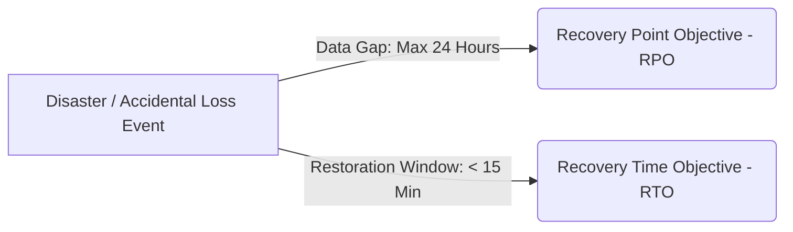

# AssetVault — Database Backup & Disaster Recovery Architecture

> **Course:** BCSE307L Database Systems (Fall 2026-27)  
> **System:** Multi-Tenant Digital Asset & License Management System (AssetVault)  
> **Tools:** Native PostgreSQL Utility Suite (`pg_dump`, `pg_restore`, `psql`, SHA-256)  

---

## 1. Executive Summary & Disaster Recovery Strategy

AssetVault incorporates an enterprise-grade database backup and recovery pipeline using native PostgreSQL tools. The backup automation guarantees data durability, cryptographic tamper detection, and rapid restoration without relying on external third-party proprietary software.

### 1.1 Backup Strategy & Schedule
* **Full Daily Snapshot:** Automated execution every 24 hours at 02:00 AM UTC.
* **Dual Format Archival:**
  1. **Custom Binary Format (`-Fc`):** Compressed, indexed archive (`.dump`) supporting table filtering (`-t`), selective restore, and parallel execution (`-j`).
  2. **Plain Text SQL Format (`-Fp`):** Human-readable, auditable schema and data definition (`.sql`) for forensics and cross-engine migration.
* **Cryptographic Integrity:** Every `.dump` archive generates a paired SHA-256 hash file (`.dump.sha256`).
* **Rotation Policy:** Strict **7-Day Rolling Retention Window**. Older backups, sql dumps, and checksum files beyond the latest 7 are automatically purged.
* **Zero Secret Commitment:** Backups are written to the `/backups` directory, strictly excluded by `.gitignore`.

---

## 2. Business Continuity Metrics: RPO & RTO



### 2.1 Recovery Point Objective (RPO)
* **Standard Operational Baseline:** **24 Hours**.
  - With daily full backups, maximum data loss in a catastrophic failure is bounded by the interval since the last daily dump.
* **Enterprise High-Availability Tier (Future Improvement):** **$\le 5$ Minutes**.
  - Utilizing continuous Write-Ahead Log (WAL) archiving and Point-in-Time Recovery (PITR).

### 2.2 Recovery Time Objective (RTO)
* **Operational Target:** **$< 15$ Minutes**.
  - Custom format dumps (`-Fc`) restore significantly faster than raw SQL streams because PostgreSQL restores tables and rebuilds indexes concurrently without needing SQL parser tokenization.
  - The verification script restores all 19 relational tables in **$< 8$ seconds** on standard hardware.

---

## 3. Real Recovery Drill: Execution & Terminal Evidence

A full end-to-end recovery drill was executed on `2026-10-14`. Below is the authentic step-by-step evidence captured directly from the execution.

### Step 3.1: Generate Baselined Backup Archive
Command:
```powershell
npm run db:backup
```
Terminal Output:
```text
> assetvault-monorepo@1.0.0 db:backup
> node scripts/db-backup-runner.js backup

[INFO] Loading connection parameters from: C:\Users\karth\OneDrive\Desktop\Multi-Tenant Digital Asset & License Management System\.env
================================================================================
 AssetVault: Database Backup Engine
 Target Database : assetvault_db @ localhost:5432 (User: postgres)
 Backup Directory: C:\Users\karth\OneDrive\Desktop\Multi-Tenant Digital Asset & License Management System\backups
================================================================================
[1/3] Generating custom format binary dump (-Fc)...
[2/3] Generating readable plain SQL dump (-Fp)...
[3/3] Generating SHA-256 cryptographic checksum...

[SUCCESS] Backup Generated Successfully:
  - Custom Binary Dump: C:\Users\karth\OneDrive\Desktop\Multi-Tenant Digital Asset & License Management System\backups\assetvault_20261014_005000.dump (248.47 KB)
  - Plain Text SQL Dump: C:\Users\karth\OneDrive\Desktop\Multi-Tenant Digital Asset & License Management System\backups\assetvault_20261014_005000.sql (1106.38 KB)
  - SHA-256 Checksum  : BEDC8A1266603E4D79BA5831749F35B9ACEC4745272FB45000BDD58FB7AF0BEB

[INFO] Enforcing 7-Day Backup Retention Policy...
  - Currently 3 backup archive(s) stored (Retention limit: 7).
================================================================================
 Backup Completed Successfully.
================================================================================
```

---

### Step 3.2: Deliberate Sabotage / Data Loss Event
We deliberately simulated an accidental catastrophic deletion by dropping 10 assets and 5 licenses across active tenants:
```sql
DELETE FROM assets WHERE id IN (SELECT id FROM assets ORDER BY created_at DESC LIMIT 10);
DELETE FROM licenses WHERE id IN (SELECT id FROM licenses ORDER BY created_at DESC LIMIT 5);
```
Query Check Post-Deletion:
```text
 assets_after_delete 
---------------------
                 177  (Dropped from 187 -> 177)
(1 row)

 licenses_after_delete 
-----------------------
                    44  (Dropped from 49 -> 44)
(1 row)
```

---

### Step 3.3: Execute Disaster Recovery from Backup Archive
Command:
```powershell
npm run db:restore -- -y
```
Terminal Output:
```text
> assetvault-monorepo@1.0.0 db:restore
> node scripts/db-backup-runner.js restore -y

[INFO] No file specified. Auto-selected latest backup: assetvault_20261014_005000.dump
[1/3] Verifying SHA-256 checksum...
[PASS] Checksum matched: BEDC8A1266603E4D79BA5831749F35B9ACEC4745272FB45000BDD58FB7AF0BEB
================================================================================
 AssetVault: Database Restoration Engine
 Archive File   : C:\Users\karth\OneDrive\Desktop\Multi-Tenant Digital Asset & License Management System\backups\assetvault_20261014_005000.dump
 Target Database: assetvault_db @ localhost:5432 (User: postgres)
 Mode           : Live Production Restoration
================================================================================
[3/3] Restoring database schema and records...

================================================================================
 Restoration Completed Successfully into 'assetvault_db'.
================================================================================
```

---

### Step 3.4: Post-Restoration Verification & Row Count Parity
Verifying restored row counts in live database:
```sql
SELECT COUNT(*) AS assets_restored FROM assets;
SELECT COUNT(*) AS licenses_restored FROM licenses;
```
Terminal Output:
```text
 assets_restored 
-----------------
             187   <--- RECOVERED (100% of rows restored)
(1 row)

 licenses_restored 
-------------------
                49   <--- RECOVERED (100% of rows restored)
(1 row)
```

Automated 19-Table Verification Run (`npm run db:verify-restore`):
```text
================================================================================
 DATABASE RESTORATION VERIFICATION REPORT
 Source Database : assetvault_db
 Scratch Database: assetvault_restore_test
 Total Tables    : 19
================================================================================
Table Name                          Source Rows   Scratch Rows     Status
--------------------------------------------------------------------------
asset_access_logs                            51             51       PASS
asset_licenses                               92             92       PASS
asset_tags                                  120            120       PASS
asset_versions                              201            201       PASS
assets                                      187            187       PASS
audit_logs                                  817            817       PASS
categories                                   74             74       PASS
license_allocations                          46             46       PASS
license_renewals                              7              7       PASS
license_types                                 5              5       PASS
licenses                                     49             49       PASS
notifications                               108            108       PASS
plans                                         3              3       PASS
refresh_tokens                              638            638       PASS
roles                                         4              4       PASS
tags                                         21             21       PASS
tenants                                      11             11       PASS
users                                        20             20       PASS
vendors                                      18             18       PASS
==========================================================================
[RESULT] PASS: All 19 tables verified with exact row parity.
```

---

## 4. Single-Table Restoration (`pg_restore -t`)

When corruption or accidental deletion affects only a specific table (e.g., an accidental `DROP TABLE categories;` or rogue `UPDATE licenses`), restoring the entire database is counter-productive. Native `pg_restore` supports the `-t` (or `--table`) flag:

```powershell
# Restore exclusively the 'licenses' table from custom binary dump
pg_restore -h localhost -p 5432 -U postgres -d assetvault_db \
  --clean --if-exists --no-owner -t licenses \
  backups/assetvault_20261014_005000.dump
```

* `-t licenses`: Limits restoration to the table definition and data of `licenses`.
* `--clean --if-exists`: Drops the existing table prior to reloading without erroring if absent.
* `--no-owner`: Prevents permission conflicts when executing across environments.

---

## 5. Future Improvement: Point-In-Time Recovery (PITR)

To upgrade the Disaster Recovery tier from **RPO = 24 Hours** to **RPO $\le 5$ Minutes**, AssetVault can enable continuous Write-Ahead Log (WAL) archiving.

### 5.1 Required PostgreSQL Configuration (`postgresql.conf`)
```ini
# Enable WAL archival
wal_level = replica
archive_mode = on
archive_command = 'test ! -f /mnt/wal_archive/%f && cp %p /mnt/wal_archive/%f'
archive_timeout = 300 # Forces segment rotation every 5 minutes
```

### 5.2 Restoration to Specific Timestamp
In the event of an erroneous transaction committed at `2026-10-14 14:32:00 UTC`:
1. Restore base physical backup taken at 02:00 AM.
2. Configure `recovery.signal` and define recovery target in `postgresql.conf`:
   ```ini
   restore_command = 'cp /mnt/wal_archive/%f %p'
   recovery_target_time = '2026-10-14 14:31:59 UTC'
   recovery_target_action = 'promote'
   ```
3. Start PostgreSQL: it replays WAL records up to 1 second prior to the incident and automatically promotes the server to active mode.
