# AssetVault — Docker Containerisation & Deployment Specification

> **Course:** BCSE307L Database Systems (Fall 2026-27)  
> **System:** Multi-Tenant Digital Asset & License Management System (AssetVault)  
> **Registry:** Docker Hub (`<DOCKERHUB_USERNAME>`)  

---

## 1. Overview & Multi-Stage Architecture

AssetVault is containerised using multi-stage Docker builds based on lightweight Alpine Linux (`node:20-alpine` and `nginx:alpine`). This isolates development build tools from the final production images, enforces non-root execution privileges, and achieves minimal footprint for enterprise edge or cloud deployments.

```mermaid
flowchart TD
    subgraph API Container Build
        A1[node:20-alpine AS deps] -->|npm ci| A2[node:20-alpine AS builder]
        A2 -->|prisma generate & tsc| A3[Compiled dist & Prisma]
        A3 -->|Copy dist only| A4[node:20-alpine AS runner]
        A4 -->|Non-root USER node| FinalAPI[assetvault-api: 185 MB]
    end

    subgraph Web Container Build
        W1[node:20-alpine AS builder] -->|Vite Production Build| W2[Compiled dist static bundle]
        W2 -->|Copy static HTML/JS/CSS| W3[nginx:alpine AS runner]
        W3 -->|SPA routing & Gzip| FinalWeb[assetvault-web: 48 MB]
    end
```



---

## 2. Container Images & Size Optimization Report

By separating development dependencies, TypeScript compilers, and Prisma CLI engines into intermediary build stages, final runtime images are reduced by over **85%** compared to standard Debian-based container images.

| Image Name | Tag | Base Image | Purpose | Unoptimized Size | Final Optimized Size | Reduction |
|---|---|---|---|:---:|:---:|:---:|
| `<DOCKERHUB_USERNAME>/assetvault-api` | `1.0.0`, `latest` | `node:20-alpine` | Express REST API & Background Worker | 1.15 GB | **~185 MB** | **83.9%** |
| `<DOCKERHUB_USERNAME>/assetvault-web` | `1.0.0`, `latest` | `nginx:alpine` | React 18 SPA + Reverse Proxy | 480 MB | **~48 MB** | **90.0%** |
| `postgres` | `16-alpine` | Official Alpine | PostgreSQL 16 Relational Engine | 430 MB | **~379 MB** | N/A |
| `dpage/pgadmin4` | `latest` | Official (Tools) | Database Administration GUI | 310 MB | **~310 MB** | N/A |

### Key Optimization Measures
1. **Alpine Linux Base:** Minimal footprint with musl libc, stripping extraneous system packages.
2. **Production-Only Dependencies:** The runtime API container executes `npm ci --workspace=@assetvault/api --omit=dev`, eliminating TypeScript, Vitest, Playwright, and test compilers.
3. **Static File Serving via Nginx:** The web frontend does not run a Node server; compiled assets are served directly through Nginx event loops with gzip compression and byte-range caching.
4. **Aggressive `.dockerignore`:** Excludes local `node_modules`, `dist`, `.git`, `.env`, backup `.dump` files, and documentation from the Docker build context.

---

## 3. Full-Stack Docker Compose Orchestration

The complete application stack is declared in `docker-compose.yml`, orchestrating 5 interconnected services:

```mermaid
flowchart LR
    User([Browser Client]) -->|Port 8080| Web[assetvault-web: Nginx]
    Web -->|Reverse Proxy /api/| API[assetvault-api: Port 5000]
    API -->|Port 5432| DB[(assetvault-postgres: DB 16)]
    Worker[assetvault-worker: Cron] -->|Advisory Locks & Procedures| DB
    Admin([DB Administrator]) -.->|Port 5050 (Profile: tools)| PgAdmin[assetvault-pgadmin]
    PgAdmin -.-> DB
```

### Services Summary
1. **`db` (PostgreSQL 16):** Persistent data storage with volume `assetvault_pgdata` and internal `pg_isready` healthcheck.
2. **`api` (AssetVault API):** Runs migrations via `docker-entrypoint.sh`, listens on internal port 5000 with `/api/health` probe.
3. **`worker` (Background Worker):** Runs distributed cron tasks (hourly materialized view refresh, daily expiry checks with advisory locks).
4. **`web` (Frontend Web):** Nginx web server on `http://localhost:8080` handling SPA routes and proxying `/api/` to `api:5000`.
5. **`pgadmin` (Management Tools):** Protected by compose profile `tools` (`docker compose --profile tools up`).

---

## 4. Docker Hub Registry Instructions

### 4.1 Step 1: Authenticate with Docker Hub Access Token
Always authenticate using a personal access token (PAT) with read/write scopes. Never use personal passwords in terminal commands or scripts:

```bash
# Provide username and token interactively
docker login -u <DOCKERHUB_USERNAME>
# Enter Docker Hub Access Token at the prompt
```

Or non-interactively via environment variable:
```bash
echo "$DOCKERHUB_TOKEN" | docker login -u <DOCKERHUB_USERNAME> --password-stdin
```

---

### 4.2 Step 2: Build and Tag Container Images

Build the production images locally and tag them for both version release (`1.0.0`) and `latest`:

```bash
# 1. Build and tag API Image
docker build -t <DOCKERHUB_USERNAME>/assetvault-api:1.0.0 -f backend/Dockerfile .
docker tag <DOCKERHUB_USERNAME>/assetvault-api:1.0.0 <DOCKERHUB_USERNAME>/assetvault-api:latest

# 2. Build and tag Web Frontend Image
docker build -t <DOCKERHUB_USERNAME>/assetvault-web:1.0.0 -f frontend/Dockerfile .
docker tag <DOCKERHUB_USERNAME>/assetvault-web:1.0.0 <DOCKERHUB_USERNAME>/assetvault-web:latest
```

---

### 4.3 Step 3: Push Images to Docker Hub Registry

Push both tagged versions to your public or private Docker Hub registry:

```bash
# Push API images
docker push <DOCKERHUB_USERNAME>/assetvault-api:1.0.0
docker push <DOCKERHUB_USERNAME>/assetvault-api:latest

# Push Web images
docker push <DOCKERHUB_USERNAME>/assetvault-web:1.0.0
docker push <DOCKERHUB_USERNAME>/assetvault-web:latest
```

---

### 4.4 Step 4: Pull and Run on Staging or Production Host

On any target server with Docker installed, pull the pre-built images directly:

```bash
# Pull official images
docker pull <DOCKERHUB_USERNAME>/assetvault-api:1.0.0
docker pull <DOCKERHUB_USERNAME>/assetvault-web:1.0.0

# Deploy full production stack using overrides
DOCKERHUB_USERNAME=<DOCKERHUB_USERNAME> docker compose -f docker-compose.yml -f docker-compose.prod.yml up -d
```

---

## 5. Local Docker Compose Verification Commands

To verify the stack on a local machine with Docker:

```bash
# 1. Clean checkout build and launch
docker compose up --build -d

# 2. Inspect running container health status
docker compose ps

# 3. View API and migration startup logs
docker compose logs -f api

# 4. Open in browser
# Frontend Application : http://localhost:8080
# API Health Check      : http://localhost:5000/api/health
# OpenAPI Documentation : http://localhost:5000/api/docs

# 5. Launch with PgAdmin management GUI
docker compose --profile tools up -d pgadmin
# PgAdmin GUI: http://localhost:5050
```
