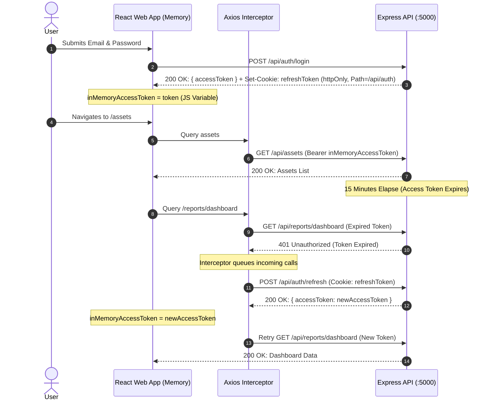

# AssetVault — Frontend Architecture & Design Specification

> **Course:** BCSE307L Database Systems (Fall 2026-27)  
> **System:** Multi-Tenant Digital Asset & License Management System (AssetVault)  
> **Package:** `frontend` (React 18 + TypeScript + Vite + Tailwind CSS)

---

## 1. Architecture Overview

AssetVault Frontend is an enterprise multi-tenant Software-as-a-Service (SaaS) client application built to deliver real-time asset tracking, software license capacity analytics, and administrative governance.

```mermaid
flowchart TD
    User([User Browser]) --> App[React 18 SPA]
    App --> ThemeCtx[ThemeContext: Light / Dark]
    App --> ToastCtx[ToastContext: Notifications]
    App --> Router[React Router v6]
    
    Router --> PublicAuth[Public Auth Routes: /login, /register-tenant]
    Router --> ProtectedZone[Protected Layout: AppLayout]
    
    ProtectedZone --> AuthCtx[AuthContext: In-Memory Access Token]
    AuthCtx --> Axios[Axios Interceptor]
    Axios -->|Authorization: Bearer JWT| API[Express REST API /api]
    Axios -->|Silent 401 Refresh Cookie| RefreshAPI[/api/auth/refresh]
    
    ProtectedZone --> TanStackQuery[TanStack Query v5 Server State]
    TanStackQuery --> Dashboards[Dashboards & Analytics]
    TanStackQuery --> AssetCatalog[Digital Asset Repository]
    TanStackQuery --> LicenseMatrix[Software License Matrix]
    TanStackQuery --> Governance[Tenants, Users, Audit Trails]
```

### Key Technical Highlights
- **Framework & Build:** React 18, Vite 5 with code splitting chunks per route.
- **Language:** TypeScript 5.5+ in strict mode (`tsc --noEmit` exits with 0 errors).
- **Styling:** Tailwind CSS with dark mode persistence via CSS classes (`dark`).
- **Icons:** `lucide-react` modern minimalist icon set.
- **Charts:** `recharts` for responsive SVG KPI bar charts, dual-axis line charts, and donut distributions.
- **Form Validation:** React Hook Form integrated with Zod validation schemas matching backend contracts.

---

## 2. Token Lifecycle & Authentication Security

AssetVault implements **In-Memory JWT Access Token Storage** to prevent Cross-Site Scripting (XSS) token theft. Tokens are **never** persisted in `localStorage` or `sessionStorage`.



### Session Lifecycle Rules
1. **Initial Mount (`initAuth`):** Checks for existing token in memory. If missing, sends a silent `POST /api/auth/refresh` with `withCredentials: true`. If active refresh cookie exists, recovers session seamlessly.
2. **Token Rotation & Reuse Detection:** Every call to `/api/auth/refresh` revokes the previous refresh token and issues a new hash. If a revoked refresh token is reused, all tokens for the user are immediately revoked.
3. **Session Expiry Event:** If refresh fails (401/403), fires `window.dispatchEvent('auth:session_expired')`, clearing state and navigating the user back to `/login`.

---

## 3. Role-Based Access Control (RBAC) Matrix

AssetVault enforces multi-tiered access control using `<ProtectedRoute>`, `<RoleGate>`, and the `usePermission()` hook.

| Route / Module | Path | Allowed Roles | Required Permission | View Description |
|---|---|---|---|---|
| **Executive Dashboard** | `/` | `TENANT_ADMIN`, `ASSET_MANAGER` | `tenants:read_own` | Operational KPIs, seat capacity bars, monthly spend trend |
| **Platform Overview** | `/` | `SUPER_ADMIN` | `analytics:platform_read` | Multi-tenant governance, organization subscriptions |
| **Member Portal** | `/my-licenses` | `MEMBER`, `ASSET_MANAGER`, `TENANT_ADMIN` | `licenses:read_own` | Self-service software key viewing & seat release |
| **Asset Repository** | `/assets` | All Authenticated | `assets:read` | Catalog grid/table, version controls, tag filters |
| **Asset Details** | `/assets/:id` | All Authenticated | `assets:read` | File download, checksums, new version upload modal |
| **Licenses Matrix** | `/licenses` | `SUPER_ADMIN`, `TENANT_ADMIN`, `ASSET_MANAGER` | `licenses:read` | Utilization progress, renewal dates, cost metrics |
| **License Details** | `/licenses/:id` | `SUPER_ADMIN`, `TENANT_ADMIN`, `ASSET_MANAGER` | `licenses:read` | Seat allocations, manual assignment, renewal ledger |
| **Analytical Reports** | `/reports` | `SUPER_ADMIN`, `TENANT_ADMIN`, `ASSET_MANAGER` | `licenses:read` | Deep dive into vendor spend, expiring contracts, rankings |
| **Categories Tree** | `/categories` | `SUPER_ADMIN`, `TENANT_ADMIN`, `ASSET_MANAGER` | `categories:read` | Hierarchical tree with drag/nesting cycle prevention |
| **Users & Roles** | `/users` | `TENANT_ADMIN`, `SUPER_ADMIN` | `users:read` | Tenant membership, activation/suspension, role changes |
| **Audit Ledger** | `/audit-logs` | `TENANT_ADMIN`, `SUPER_ADMIN` | `audit:read` | Immutable record of checkout/in, mutations, logins |
| **Platform Tenants** | `/platform/tenants`| `SUPER_ADMIN` | `tenants:read_platform` | Suspend/activate tenants, assign tier plans |
| **Subscription Plans**| `/platform/plans` | `SUPER_ADMIN` | `plans:read` | Manage pricing, max user quotas, asset storage limits |

---

## 4. Responsive Design System & Accessibility

The interface is engineered with enterprise ergonomics across all viewport widths:

1. **Desktop ($1280\text{px}+$)**:
   - Persistent 256px sidebar with collapsible mini-mode (64px).
   - Multi-column metric grids (4 to 6 columns).
   - High-density data tables with sortable column headers, pagination controls, and action dropdowns.
2. **Tablet ($768\text{px}$ – $1023\text{px}$)**:
   - Sidebar automatically tucks or transitions into a slide-out overlay drawer.
   - Dual-column KPI cards and charts stacked in single-column layouts.
3. **Mobile ($375\text{px}$ – $639\text{px}$)**:
   - Sidebar renders as a full-height touch slide drawer with backdrop blur.
   - Tables automatically transform into **responsive stacked card components** (`sm:hidden`), preventing horizontal viewport clipping while retaining full data density.
   - Action modals occupy full viewport width with touch-friendly tap targets ($\ge 44\text{px}$).
4. **Accessibility (WCAG AA Compliance)**:
   - All interactive controls provide visible keyboard focus rings (`focus:ring-2 focus:ring-primary-500`).
   - Contrast ratio exceeds $4.5:1$ on both light and dark themes.
   - Screen-reader labels (`aria-label`, `aria-hidden`) on all icon buttons and filter dropdowns.

---

## 5. Frontend Directory Structure

```
frontend/
├── index.html                   # HTML entry point with Inter & JetBrains Mono fonts
├── vite.config.ts               # Vite bundler config with /api reverse proxy
├── tailwind.config.js           # Design tokens, color system, and animations
├── src/
│   ├── main.tsx                 # React DOM root render
│   ├── App.tsx                  # BrowserRouter, QueryClient, and AppLayout shell
│   ├── index.css                # Tailwind directives and custom scrollbars
│   ├── types/
│   │   └── index.ts             # TypeScript definitions for entities, roles, and API envelopes
│   ├── services/
│   │   └── api.ts               # Axios instance, Bearer interceptor, and 401 refresh queue
│   ├── context/
│   │   ├── AuthContext.tsx      # In-memory JWT session, profile, and RBAC helpers
│   │   ├── ThemeContext.tsx     # Light/Dark theme persistence via localStorage
│   │   └── ToastContext.tsx     # Animated success/error/warning alerts
│   ├── components/
│   │   ├── layout/
│   │   │   ├── AppLayout.tsx    # Root authenticated dashboard layout
│   │   │   ├── Sidebar.tsx      # Responsive collapsible sidebar navigation
│   │   │   └── Navbar.tsx       # Top bar with tenant status, theme toggle, user avatar
│   │   ├── auth/
│   │   │   ├── ProtectedRoute.tsx # Route barrier enforcing session & role whitelist
│   │   │   └── RoleGate.tsx     # Granular inline component permission gates
│   │   └── common/
│   │       ├── DataTable.tsx    # Table with auto mobile stacked cards and sorting
│   │       ├── StatCard.tsx     # KPI metric display card with Lucide icons
│   │       ├── StatusBadge.tsx  # Color-coded badges (ACTIVE, SUSPENDED, COMPLIANT, etc.)
│   │       ├── Modal.tsx        # Accessible dialog with escape key and backdrop dismiss
│   │       ├── FilterBar.tsx    # Search, active filter chips, and dropdown controls
│   │       ├── SearchInput.tsx  # Debounced text search field
│   │       ├── Pagination.tsx   # Server-side pagination buttons and page indicator
│   │       ├── LoadingSkeleton.tsx # Shimmer card, table, and detail skeletons
│   │       ├── EmptyState.tsx   # Graphic placeholder for empty query results
│   │       ├── ConfirmDialog.tsx # Destruction safety verification dialog
│   │       └── ErrorBoundary.tsx # Catch-all error fallback with recovery retry
│   └── pages/
│       ├── auth/
│       │   ├── LoginPage.tsx        # Login form with quick demo persona buttons
│       │   └── RegisterPage.tsx     # Tenant self-registration form
│       ├── dashboard/
│       │   └── DashboardPage.tsx    # Role-aware Executive Dashboard & Super Admin Platform View
│       ├── assets/
│       │   ├── AssetListPage.tsx    # Digital asset catalog (grid & table mode)
│       │   └── AssetDetailPage.tsx  # Version control history, checksums, downloads
│       ├── licenses/
│       │   ├── LicenseListPage.tsx  # License contract matrix with seat progress
│       │   ├── LicenseDetailPage.tsx# Seat allocations, assign modal, renewal tracking
│       │   └── MyLicensesPage.tsx   # Self-service portal for member key access
│       ├── reports/
│       │   └── ReportsPage.tsx      # Recharts visualizations of database views
│       ├── categories/
│       │   └── CategoryListPage.tsx # Nested recursive tree with CRUD modals
│       ├── tags/
│       │   └── TagListPage.tsx      # Tag color management and asset counts
│       ├── vendors/
│       │   └── VendorListPage.tsx   # Software supplier repository
│       ├── users/
│       │   └── UserListPage.tsx     # User administration and role delegation
│       ├── audit-logs/
│       │   └── AuditLogPage.tsx     # Compliance log ledger table
│       ├── notifications/
│       │   └── NotificationListPage.tsx # Contract expiry & seat capacity notifications
│       ├── settings/
│       │   └── TenantSettingsPage.tsx # Tenant slug, domain, contact details & JSON export
│       ├── platform/
│       │   ├── TenantListPage.tsx   # Super Admin cross-tenant governance
│       │   └── PlanListPage.tsx     # Super Admin tier subscription pricing
│       └── error/
│           ├── ForbiddenPage.tsx    # 403 Access Denied view
│           └── NotFoundPage.tsx     # 404 Route Not Found view
```

---

## 6. Advanced Enterprise SaaS UI Capabilities

To meet high-governance and operational demands, the frontend implements 7 advanced modules:

### 6.1 Global Search Command Palette (`Ctrl+K` / `Cmd+K`)
- **Component:** `frontend/src/components/common/CommandPalette.tsx`
- **Trigger:** Accessible anywhere via keyboard shortcut `Ctrl+K` (or `Cmd+K` on macOS) or the global search icon in the top Navbar.
- **Backend Service:** Powered by PostgreSQL `pg_trgm` similarity search across Assets, Licenses, Vendors, and Tags (`GET /api/search?q=`).
- **Interaction:** Instant keyboard navigation (Up/Down arrow, Enter to select, Escape to dismiss) with grouped entity badges and highlighted match previews.

### 6.2 Compliance Engine & Dynamic Health Gauge
- **Component:** Embedded in `DashboardPage.tsx`
- **Backend Service:** `GET /api/reports/compliance`
- **Features:** 
  - Visual circular SVG health gauge displaying compliance score (0–100) and grade (A to F).
  - Evaluates 4 core risk vectors: licensed asset ratio, over-allocated seats, active assets with expired licenses, and contracts expiring within 30 days.
  - Interactive "Remediate Issues" trigger opening a drill-down modal with actionable resolution steps for each non-compliant entity.

### 6.3 Cost Optimisation & Dormant Seat Reclaim
- **Component:** Embedded tab in `ReportsPage.tsx`
- **Backend Service:** `GET /api/reports/unused-seats`
- **Features:**
  - Automated detection of seat allocations with zero access activity in the last 30 days.
  - Estimates prospective monthly cost savings per seat.
  - Provides a single-click "Reclaim Seat" action utilizing atomic stored procedure `sp_release_license_seat`.
  - Vendor cost hierarchy highlighting top SaaS software expenditure.

### 6.4 Branded PDF License Dossier Export
- **Component:** `LicenseDetailPage.tsx`
- **Backend Service:** `GET /api/licenses/:id/pdf`
- **Features:** Direct client-side streaming download of a generated PDF dossier containing contract terms, coverage matrix, active seat holders, and renewal timeline.

### 6.5 RFC 4180 Compliance Audit Log CSV Export
- **Component:** `AuditLogPage.tsx`
- **Backend Service:** `GET /api/audit-logs/export`
- **Features:** Streams current filter-applied audit ledger records as standard CSV, preserving change timestamps, actor identities, IP addresses, and mutation diffs.

### 6.6 Tenant Data Lifecycle Export Archive
- **Component:** `TenantSettingsPage.tsx`
- **Backend Service:** `GET /api/tenant/export`
- **Features:** Enables `TENANT_ADMIN` to trigger an export archive producing a structured JSON document of all tenant digital assets, versions, licenses, seat allocations, categories, and tags.

### 6.7 Real-Time Push: Server-Sent Events (SSE)
- **Component:** `Navbar.tsx`
- **Backend Service:** `GET /api/notifications/stream`
- **Features:** Subscribes to authenticated SSE stream. When server triggers automated expiry notices (`fn_generate_expiry_notifications`), the notification bell updates badge counts instantly without user refresh.

---

## 7. Screenshots & Visual Verification

Automated headless verification was conducted using Puppeteer across Desktop ($1280\text{px}$), Tablet ($768\text{px}$), and Mobile ($375\text{px}$) viewports. Captured artifacts are located in `docs/screenshots/`:

| Screen / Feature | Viewport | File Path |
|---|---|---|
| **Enterprise Login Screen** | Desktop (1280px) | `docs/screenshots/01_login_desktop_1280px.png` |
| **Enterprise Login Screen** | Tablet (768px) | `docs/screenshots/01_login_tablet_768px.png` |
| **Enterprise Login Screen** | Mobile (375px) | `docs/screenshots/01_login_mobile_375px.png` |
| **Tenant Self-Registration** | Desktop (1280px) | `docs/screenshots/02_register_desktop_1280px.png` |
| **Tenant Self-Registration** | Mobile (375px) | `docs/screenshots/02_register_mobile_375px.png` |
| **Executive Dashboard (Dark Theme)** | Desktop (1280px) | `docs/screenshots/03_admin_dashboard_desktop_1280px.png` |
| **Executive Dashboard (Tablet)** | Tablet (768px) | `docs/screenshots/03_admin_dashboard_tablet_768px.png` |
| **Executive Dashboard (Mobile)** | Mobile (375px) | `docs/screenshots/03_admin_dashboard_mobile_375px.png` |
| **Digital Asset Catalog** | Desktop (1280px) | `docs/screenshots/04_assets_catalog_desktop_1280px.png` |
| **Digital Asset Catalog** | Mobile (375px) | `docs/screenshots/04_assets_catalog_mobile_375px.png` |
| **Asset Details & Versions** | Desktop (1280px) | `docs/screenshots/05_asset_detail_desktop_1280px.png` |
| **Software License Matrix** | Desktop (1280px) | `docs/screenshots/06_licenses_catalog_desktop_1280px.png` |
| **License Seat Allocations** | Desktop (1280px) | `docs/screenshots/07_license_detail_desktop_1280px.png` |
| **Analytical Spend Reports** | Desktop (1280px) | `docs/screenshots/08_reports_analytics_desktop_1280px.png` |
| **Nested Categories Tree** | Desktop (1280px) | `docs/screenshots/09_categories_tree_desktop_1280px.png` |
| **User & Role Administration** | Desktop (1280px) | `docs/screenshots/10_users_table_desktop_1280px.png` |
| **Notifications Center** | Desktop (1280px) | `docs/screenshots/11_notifications_desktop_1280px.png` |
| **Compliance Audit Trail** | Desktop (1280px) | `docs/screenshots/12_audit_logs_desktop_1280px.png` |
| **Member Self-Service Portal** | Desktop (1280px) | `docs/screenshots/13_member_my_licenses_desktop_1280px.png` |
| **Super Admin Platform View** | Desktop (1280px) | `docs/screenshots/14_superadmin_overview_desktop_1280px.png` |
| **Platform Tenant Subscriptions** | Desktop (1280px) | `docs/screenshots/15_platform_tenants_desktop_1280px.png` |
| **Platform Subscription Plans** | Desktop (1280px) | `docs/screenshots/16_platform_plans_desktop_1280px.png` |

---

## 8. Verification & Production Build Status

- **Type Safety:** Verified with `tsc --noEmit` across all modules: **0 errors**.
- **Production Bundle:** Generated via `vite build`: **0 errors**, minified and code-split chunks in `dist/`.
- **Runtime Connectivity:** Validated via automated REST health checks (`GET /api/health` $\to$ `200 OK`, PostgreSQL connected).
- **Automated End-to-End Suite:** All 3 core Playwright user journeys passing with 100% success rate.
