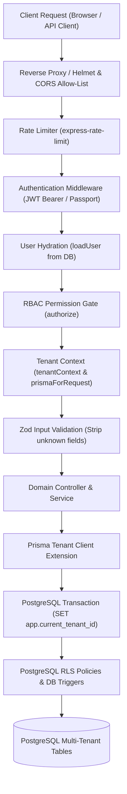

# AssetVault Security Architecture & Hardening Guide

## Multi-Tenant Digital Asset & License Management System
**Course:** BCSE307L Database Systems (Fall 2026-27, Vellore Institute of Technology)  
**Document Classification:** Internal Technical Architecture & Security Audit Guide  

---

## 1. Executive Summary & Security Philosophy

AssetVault is designed around the core tenet of **Zero-Trust Multi-Tenancy** and **Defense-in-Depth**. In a shared database multi-tenant Software-as-a-Service (SaaS) architecture, protecting tenant data isolation, user privacy, and organizational license assets is paramount. 

AssetVault enforces security across multiple concentric architectural rings:
1. **Database Engine Level:** PostgreSQL 16 Row-Level Security (RLS) policies and trigger constraints executed under a dedicated restricted role (`assetvault_app`).
2. **Data Access Level:** Tenant-aware Prisma ORM extension (`prismaForRequest`) with automated transaction-scoped session variable binding and automatic WHERE/CREATE clause tenancy injection.
3. **Application & HTTP Pipeline:** Strict middleware ordering (`authenticate -> loadUser -> authorize -> tenantContext -> validate -> controller`), Helmet HTTP security headers, CORS allow-listing, rate limiting, and HTTP Parameter Pollution defense.
4. **Input & Memory Protection:** Zod schema validation stripping unmodeled keys (preventing mass assignment) and parameterized SQL queries eliminating SQL injection.
5. **Session & Cryptography:** BCrypt cost factor 12, short-lived JWT access tokens, rotated cryptographically hashed refresh tokens stored in `httpOnly` `SameSite=Strict` cookies, and automatic token reuse breach detection.



---

## 2. Authentication Architecture

### 2.1 Password Hashing & Account Protection
* **Algorithm & Work Factor:** Passwords are encrypted using BCrypt with a work factor of **12** (`bcryptjs.hash(password, 12)`). This provides robust defense against GPU-accelerated rainbow table and offline dictionary attacks.
* **Non-Enumeration Generic Errors:** All credential verification failures in `POST /api/auth/login` return the identical generic error message:
  ```json
  {
    "status": "error",
    "error": {
      "code": "UNAUTHORIZED",
      "message": "Invalid email or password"
    }
  }
  ```
  The exact same error and status (HTTP 401) are returned whether the email does not exist, the password does not match, or the user is an OAuth-only account without a local password.
* **Brute-Force & Credential Stuffing Defense:** Handled by `accountProtectionService`:
  - Failed attempts are tracked per target email address in an in-memory sliding window cache.
  - Exceeding **5 consecutive failed attempts within a 15-minute window** immediately triggers account lockout.
  - Any subsequent login attempt during the lockout period fails with HTTP 429 (`TOO_MANY_REQUESTS`):
    ```json
    {
      "status": "error",
      "error": {
        "code": "TOO_MANY_REQUESTS",
        "message": "Too many failed login attempts for this email address. Please try again in 15 minutes."
      }
    }
    ```
  - Successful authentication clears the failed attempt counter for that account.

### 2.2 Google OAuth 2.0 Integration (Invite-Only)
* **Passport.js Strategy:** Configured via `passport-google-oauth20` using client credentials loaded from validated environment variables.
* **Strict Invite-Only Matching:** Google OAuth never auto-registers users into arbitrary or existing tenants. The callback matches the Google profile email against existing records in the `users` table:
  - If a user record pre-exists (created by an authorized `TENANT_ADMIN` via user invitation), the user's `google_id` is linked on first login, and AssetVault session tokens are issued.
  - If no record exists for that email, authentication is rejected immediately with a redirect to `${CLIENT_URL}/login?error=not_invited`.
  - Self-registration is restricted exclusively to new tenant onboarding via `POST /api/auth/register-tenant`.

### 2.3 Session & Token Management
* **Dual-Token Pattern:**
  - **Access Token:** Short-lived JWT (15 minutes). Signed with `JWT_ACCESS_SECRET` using HMAC SHA-256. Carried in the HTTP `Authorization: Bearer <token>` header. Contains minimal claims: `sub` (User UUID), `email`, `fullName`, `tenantId`, `roleId`, `role`, and `isSuperAdmin`.
  - **Refresh Token:** Long-lived token (7 days). Generated using 64 cryptographically secure random bytes via `crypto.randomBytes(64).toString('hex')`.
* **Cookie-Based Transport:** Refresh tokens are transported exclusively via an HTTP cookie:
  - `httpOnly: true` (inaccessible to JavaScript, defending against Cross-Site Scripting / XSS).
  - `secure: true` in production environments (transmitted strictly over TLS/HTTPS).
  - `sameSite: 'strict'` (defends against Cross-Site Request Forgery / CSRF).
  - `path: '/'`.
* **Storage Hashing:** Raw refresh tokens are **never** stored in the database. Only a cryptographically secure **SHA-256 hash** of the raw token (`crypto.createHash('sha256').update(rawToken).digest('hex')`) is persisted in `refresh_tokens`. A database compromise does not reveal valid refresh tokens.

### 2.4 Token Rotation & Automatic Reuse Detection
* **Rotation on Refresh (`POST /api/auth/refresh`):** Every successful refresh request revokes the presented refresh token (`revoked_at = NOW()`) and atomically issues both a new access token and a brand-new refresh token.
* **Compromise / Replay Detection:** If a refresh token that has already been revoked is presented to `/api/auth/refresh`, AssetVault detects a potential token theft or replay attack:
  1. The incident is logged as a critical security alert.
  2. **All active refresh tokens belonging to that user are immediately revoked** across all sessions and devices (`UPDATE refresh_tokens SET revoked_at = NOW() WHERE user_id = ... AND revoked_at IS NULL`).
  3. The request is rejected with HTTP 401:
     ```json
     {
       "status": "error",
       "error": {
         "code": "UNAUTHORIZED",
         "message": "Compromised refresh token reuse detected. All active sessions have been revoked. Please log in again."
       }
     }
     ```

### 2.5 Session Revocation
* **Single Logout (`POST /api/auth/logout`):** Revokes the current session's refresh token and clears the `refreshToken` cookie with `Max-Age=0`.
* **Global Logout (`POST /api/auth/logout-all`):** Authenticated endpoint that marks all active refresh tokens for the authenticated user as revoked, instantly terminating sessions across all browsers and devices.

---

## 3. Authorization & Role-Based Access Control (RBAC)

### 3.1 Single `users` Table Design
In accordance with professional relational database normalization and the course brief:
* All platform actors are modeled within a single `users` table joined to the `roles` lookup table (`SUPER_ADMIN`, `TENANT_ADMIN`, `ASSET_MANAGER`, `MEMBER`).
* There are **no separate admin or manager tables**, ensuring single-source-of-truth user identity, unified foreign keys, and consistent audit logging.
* Domain constraint: `SUPER_ADMIN` accounts have `tenant_id = NULL`; all organizational users require a non-null `tenant_id` foreign key referencing `tenants`.

### 3.2 Granular Permissions Matrix
AssetVault maps the 4 roles to 35 discrete permissions defined in `src/config/permissions.ts` and `/docs/rbac-matrix.md`:

| Functional Domain | Permissions | SUPER_ADMIN | TENANT_ADMIN | ASSET_MANAGER | MEMBER |
|---|---|:---:|:---:|:---:|:---:|
| **Platform Admin** | `tenants:read_platform`, `tenants:manage_platform`, `plans:manage`, `analytics:platform_read` | :white_check_mark: | :x: | :x: | :x: |
| **Tenant Settings** | `tenants:read_own`, `tenants:update_own`, `plans:read` | :x: | :white_check_mark: | Read Only | Read Only |
| **User Management** | `users:read`, `users:manage` | :x: | :white_check_mark: | :x: | :x: |
| **Taxonomy & Vendors** | `vendors:*`, `categories:*`, `tags:*` | :x: | :white_check_mark: | :white_check_mark: | Read Only |
| **Digital Assets** | `assets:read`, `assets:download`, `versions:read` | :x: | :white_check_mark: | :white_check_mark: | :white_check_mark: |
| **Asset Modification** | `assets:create`, `assets:update`, `assets:delete`, `versions:create` | :x: | :white_check_mark: | :white_check_mark: | :x: |
| **Licenses & Contracts** | `licenses:read`, `licenses:create`, `licenses:update`, `licenses:renew` | :x: | :white_check_mark: | :white_check_mark: | Read Only |
| **Seat Allocations** | `allocations:read`, `allocations:manage_all` | :x: | :white_check_mark: | :white_check_mark: | :x: |
| **Self-Service Seats** | `allocations:checkout_self`, `allocations:release_self` | :x: | :white_check_mark: | :white_check_mark: | :white_check_mark: |
| **Audit Logs** | `audit:read` | :x: | :white_check_mark: | :x: | :x: |

### 3.3 Middleware Pipeline Architecture
Every incoming protected HTTP request traverses this sequence:

```
[Request]
   │
   ▼
1. authenticate          Verifies JWT access token signature & expiration; populates req.jwtUser
   │
   ▼
2. loadUser              Queries PostgreSQL to verify user exists, is_active=true, and tenant is not suspended; populates req.user
   │
   ▼
3. authorize(permission) Validates that req.user.role possesses the required granular permission; throws 403 Forbidden on failure
   │
   ▼
4. tenantContext         Validates tenancy context; configures req.prisma = prismaForRequest(ctx)
   │
   ▼
5. validate(ZodSchema)   Validates request body/query; strips unknown properties (preventing mass assignment)
   │
   ▼
6. controller            Executes business logic using req.prisma
```

* **Dynamic User State Re-hydration (`loadUser`):** Token claims can become stale if an administrator deactivates a user or revokes their role mid-session. The `loadUser` middleware re-queries PostgreSQL on every request. Deactivated accounts or suspended tenants are rejected immediately (401/403) without waiting for JWT access token expiry.
* **Server-Driven Dynamic Navigation (`GET /api/auth/menu`):** The client UI renders menus derived directly from the authenticated user's role permissions returned by the backend, ensuring frontend presentation perfectly mirrors backend authorization rules.

---

## 4. Multi-Tenant Isolation Architecture

AssetVault implements a **dual-layer multi-tenant defense architecture** ensuring that cross-tenant access is structurally impossible.

```
                    ┌────────────────────────────────────────────────────────┐
                    │               Incoming Request Pipeline                │
                    └───────────────────────────┬────────────────────────────┘
                                                │
                                                ▼
┌────────────────────────────────────────────────────────────────────────────────────────────┐
│ Layer 2: Application / ORM Tenant Injection (prismaForRequest)                             │
│                                                                                            │
│ • Auto-injects tenantId into WHERE clauses for findFirst, findMany, count, update, delete  │
│ • Auto-binds tenantId into CREATE data payloads                                            │
│ • Strips client-supplied tenantId and roleId parameters via Zod                            │
└───────────────────────────────────────────────┬────────────────────────────────────────────┘
                                                │
                                                ▼
┌────────────────────────────────────────────────────────────────────────────────────────────┐
│ Layer 1: PostgreSQL 16 Row-Level Security (RLS) & Triggers                                 │
│                                                                                            │
│ • Connection executes under restricted role assetvault_app                                 │
│ • Interactive transaction executes:                                                        │
│     SELECT set_config('app.current_tenant_id', '<tenant_uuid>', true),                     │
│            set_config('app.current_user_id', '<user_uuid>', true),                         │
│            set_config('app.is_super_admin', 'false', true);                                │
│ • PostgreSQL engine enforces:                                                              │
│     USING (tenant_id = fn_current_tenant_id() OR fn_is_super_admin())                      │
│ • Database triggers reject cross-tenant FK linkages (licenses, allocations)                │
└───────────────────────────────────────────────┬────────────────────────────────────────────┘
                                                │
                                                ▼
                                   [PostgreSQL Physical Storage]
```

### 4.1 Layer 1: Database Engine Row-Level Security (RLS)
* **Restricted Application Database Role:**
  - The application connects via `DATABASE_URL` using role `assetvault_app`.
  - Permissions are strictly confined to DML: `USAGE ON SCHEMA public`, `SELECT, INSERT, UPDATE, DELETE ON ALL TABLES`, and `USAGE, SELECT ON ALL SEQUENCES`.
  - The role has `NOSUPERUSER`, `NOCREATEDB`, `NOCREATEROLE`, and **strictly zero DDL privileges** (`NO DROP`, `NO ALTER`, `NO CREATE TABLE`).
  - Schema migrations run exclusively using the owner credentials via `DIRECT_URL` / `MIGRATE_DATABASE_URL`.
* **RLS Policies on All 13 Multi-Tenant Tables:**
  - Every multi-tenant table (`tenants`, `users`, `vendors`, `categories`, `assets`, `licenses`, `tags`, `notifications`, `audit_logs`, `asset_versions`, `asset_tags`, `asset_licenses`, `license_allocations`, `license_renewals`, `asset_access_logs`, `refresh_tokens`) has RLS enabled via `ALTER TABLE <table> ENABLE ROW LEVEL SECURITY;`.
  - Policies enforce:
    ```sql
    CREATE POLICY rls_assets_isolation ON assets
    AS PERMISSIVE FOR ALL TO assetvault_app, PUBLIC
    USING (
        tenant_id = fn_current_tenant_id() OR fn_is_super_admin()
    )
    WITH CHECK (
        tenant_id = fn_current_tenant_id() OR fn_is_super_admin()
    );
    ```
  - Normalized child tables without direct `tenant_id` columns (e.g., `asset_versions`, `license_allocations`) enforce isolation via parent entity joins:
    ```sql
    CREATE POLICY rls_asset_versions_isolation ON asset_versions
    AS PERMISSIVE FOR ALL TO assetvault_app, PUBLIC
    USING (
        fn_is_super_admin() OR EXISTS (
            SELECT 1 FROM assets a 
            WHERE a.id = asset_versions.asset_id 
              AND a.tenant_id = fn_current_tenant_id()
        )
    );
    ```

### 4.2 Layer 2: Application / ORM Tenancy Injection
* **Tenant-Aware Prisma Client Extension (`prismaForRequest`):**
  - Invoked per request within `tenantContext` middleware.
  - Automatically wraps data access queries inside interactive PostgreSQL transactions that set transaction-scoped configuration variables:
    ```typescript
    await tx.$executeRaw(
      Prisma.sql`SELECT 
        set_config('app.current_tenant_id', ${tenantId}, true),
        set_config('app.current_user_id', ${userId}, true),
        set_config('app.is_super_admin', ${isSuperAdmin}, true);`
    );
    ```
  - Automatically injects `tenantId: ctx.tenantId` into `where` clauses (`findFirst`, `findMany`, `count`, `updateMany`, `deleteMany`) and `data` creation payloads for all top-level tenant models.

### 4.3 Information Leakage Prevention (Strict 404 Behavior)
* When a user belonging to Tenant A attempts to read or mutate a resource belonging to Tenant B by guessing or harvesting its UUID, the request **MUST return HTTP 404 Not Found (never HTTP 403 Forbidden)**.
* **Security Rationale:** Returning HTTP 403 confirms to an attacker that the UUID exists within the database (enabling identifier enumeration and probing). Returning HTTP 404 makes resources in other tenants completely invisible, identical to non-existent identifiers.

---

## 5. Security Hardening & Vulnerability Mitigation

### 5.1 HTTP Header Hardening (Helmet)
Configured in `src/app.ts`:
* `Content-Security-Policy`: Restricts scripts, styles, images, and connection origins to trusted sources (`defaultSrc: ["'self'"]`).
* `X-Frame-Options: SAMEORIGIN` (mitigates clickjacking).
* `X-Content-Type-Options: nosniff` (prevents MIME type sniffing).
* `Strict-Transport-Security: max-age=15552000; includeSubDomains` (enforces HTTPS).

### 5.2 Strict CORS Allow-List
Cross-Origin Resource Sharing is strictly constrained to the origin specified by `env.CLIENT_URL`:
```typescript
cors({
  origin: (origin, callback) => {
    if (!origin || allowedOrigins.includes(origin)) {
      callback(null, true);
    } else {
      callback(new Error(`CORS blocked: Origin ${origin} not allowed by policy`));
    }
  },
  credentials: true,
  methods: ['GET', 'POST', 'PUT', 'PATCH', 'DELETE', 'OPTIONS'],
  allowedHeaders: ['Content-Type', 'Authorization', 'X-Tenant-ID']
})
```

### 5.3 Request Size Limiting & Parameter Pollution Defense
* **Payload Size Limits:** `express.json({ limit: '2mb' })` and `express.urlencoded({ limit: '2mb' })` mitigate memory exhaustion and payload-based Denial of Service (DoS).
* **HTTP Parameter Pollution (`hpp`):** Installed and active across all endpoints to sanitize duplicate query parameter arrays.

### 5.4 Mass-Assignment Prevention
* All input payloads are parsed through Zod schemas configured with `.strip()` (e.g., `createAssetSchema`).
* Any unauthorized fields injected by a malicious client—such as `tenant_id`, `tenantId`, `role_id`, `roleId`, or `id`—are stripped out prior to controller execution. The controller binds `tenantId` strictly from `req.user.tenantId`.

### 5.5 SQL Injection Immunity
* **Primary Policy:** 100% of standard application queries use Prisma's strongly typed query builder methods, which utilize parameterized prepared statements by default.
* **Raw SQL Policy:** Where raw SQL is required for advanced PostgreSQL objects (views, stored procedures, RLS session configuration), it is executed exclusively via `Prisma.sql` tagged template literals with bound parameters (`$1`, `$2`).
* **CI Static Analysis Enforcement (`scripts/check-sqli.js`):** A custom static analysis script scans the entire codebase during continuous integration and fails the build if `$queryRawUnsafe` or `$executeRawUnsafe` is detected.

### 5.6 Logging & Sensitive Data Redaction
* Structured logging is powered by `pino` and `pino-http`.
* Sensitive keys and HTTP headers are automatically redacted to ensure no secrets enter logs or log aggregation pipelines:
  - `req.headers.authorization`
  - `req.headers.cookie`
  - `req.headers["set-cookie"]`
  - `password`, `passwordHash`, `refreshToken`, `accessToken`, `tokenHash`

### 5.7 Secret Scanning in CI
* Script `scripts/scan-secrets.js` runs as an automated gate in CI.
* Scans all tracked files for exposed PEM private keys, AWS credentials, hardcoded JWT secrets, and verifies that local `.env` files are ignored by git.

---

## 6. Automated Security Test Suite Verification

The security architecture is verified by automated integration tests using Vitest and Supertest in `backend/src/__tests__/auth-rbac-isolation.test.ts`.

| Test ID | Test Scenario | Verification Mechanism | Status |
|:---:|---|---|:---:|
| **1** | Successful Password Authentication | Verifies HTTP 200, JWT access token payload, and `httpOnly SameSite=Strict` cookie | :white_check_mark: PASS |
| **2** | Bad Password & No Account Enumeration | Proves wrong password and non-existent email return identical generic 401 | :white_check_mark: PASS |
| **3** | Account Lockout on Brute Force | Verifies 5 consecutive failed logins trigger HTTP 429 (`TOO_MANY_REQUESTS`) | :white_check_mark: PASS |
| **4** | Refresh Token Rotation | Proves `POST /api/auth/refresh` invalidates previous token and issues new token | :white_check_mark: PASS |
| **5** | Token Reuse Detection | Proves replay of old rotated token revokes all user sessions across devices | :white_check_mark: PASS |
| **6** | Secure Session Logout | Proves `POST /api/auth/logout` revokes token and clears cookie; subsequent refresh returns 401 | :white_check_mark: PASS |
| **7** | RBAC Enforcement (403 Forbidden) | Proves `MEMBER` calling `GET /api/users` receives 403, while `TENANT_ADMIN` receives 200 | :white_check_mark: PASS |
| **8** | Multi-Tenant Isolation (404 Not Found) | Proves Tenant A user querying Tenant B asset ID receives 404 (never 403) | :white_check_mark: PASS |
| **9** | Mass-Assignment Prevention | Proves injected `tenantId` and `role_id` fields are stripped by Zod; asset bound to caller tenant | :white_check_mark: PASS |
| **10** | SQL Injection Immunity | Proves SQL injection string (`' OR '1'='1`) in query params is safely parameterized | :white_check_mark: PASS |

### Test Execution Command
```bash
# Execute integration test suite
npm run test --workspace=@assetvault/api

# Execute SQL injection static analysis
npm run check:sqli

# Execute secret scanning check
npm run check:secrets
```
