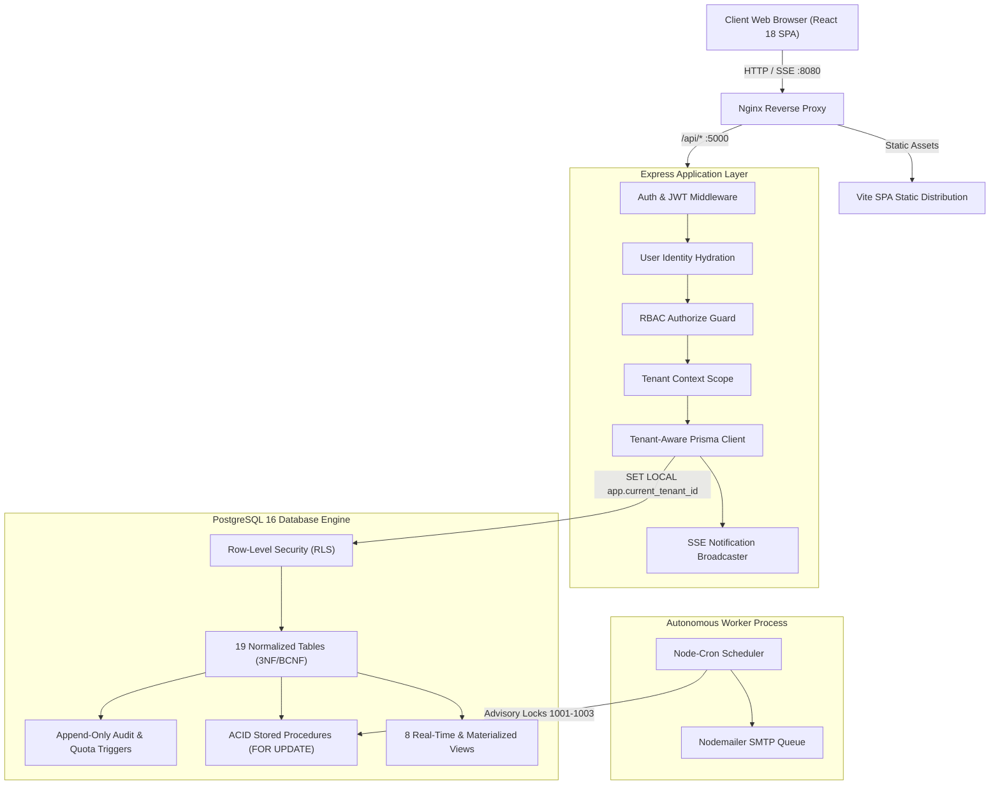
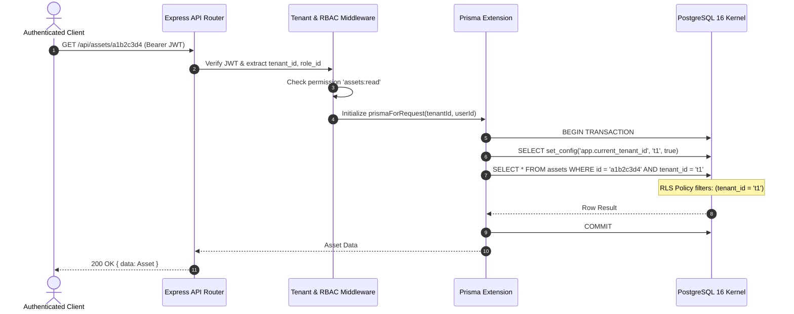
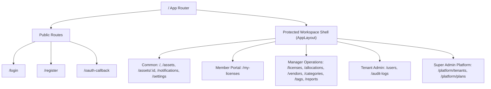

# AssetVault: Comprehensive Technical Architecture & Project Analysis

**System:** AssetVault (Multi-Tenant Digital Asset & License Management System)  
**Author / Lead Architect:** Karthikeyan S  
**Course Context:** BCSE307L — Database Systems (Fall Semester 2026–27)  
**Academic Institution:** School of Computer Science and Engineering (SCOPE), Vellore Institute of Technology (VIT), Vellore  
**Core Technologies:** PostgreSQL 16, Prisma ORM, Express TypeScript, React 18, Vite 5, Tailwind CSS, Docker, Prometheus & Grafana  

---

## 1. Executive Summary

**AssetVault** is an enterprise-grade, multi-tenant Software-as-a-Service (SaaS) platform engineered to govern digital assets (fonts, brand collateral, binaries, datasets, documents) alongside commercial and open-source software licenses, vendor contracts, seat allocations, compliance audits, and renewal lifecycles.

Unlike typical monolithic CRUD applications, AssetVault was architected from the database kernel up, using strict **Boyce-Codd Normal Form (BCNF) / Third Normal Form (3NF)** principles on PostgreSQL 16. It guarantees absolute tenant data isolation through a **dual-layer multi-tenancy model** (combining application-level query injection with PostgreSQL session-scoped Row-Level Security policies) and eliminates concurrency race conditions during seat checkouts via PL/pgSQL stored procedures using row-level locking (`SELECT ... FOR UPDATE`).



---

## 2. System Architecture & Dual-Layer Multi-Tenancy

AssetVault uses a **Pooled Schema Multi-Tenant Architecture** (shared database, shared schema across all tenants). This approach delivers high compute and memory efficiency while requiring stringent defenses against cross-tenant data leakage (Insecure Direct Object References - IDOR).

### Dual-Layer Isolation Mechanism

| Layer | Component | Implementation | Behavior on Violation |
| :--- | :--- | :--- | :--- |
| **Layer 1 (Database)** | PostgreSQL Row-Level Security (RLS) | `SET LOCAL app.current_tenant_id = $id;`<br>`CREATE POLICY ... USING (tenant_id = fn_current_tenant_id() OR fn_is_super_admin())` | Query returns empty set; non-permitted mutations blocked by PostgreSQL engine |
| **Layer 2 (Application)** | Prisma Client Extension (`prismaForRequest`) | Auto-injects `where: { tenantId }` into `findFirst`, `findMany`, `count`, `aggregate`, and sets `connect: { id: tenantId }` on `create` | Cross-tenant parameter injection stripped before query execution |
| **Anti-Enumeration** | Tenant Scoping Middleware | `tenantScope.middleware.ts` compares requested resource tenant with verified JWT token | **Returns `404 Not Found`** (never `403 Forbidden`) to prevent resource ID enumeration |



---

## 3. Database Design & Relational Engineering

The database foundation is located in [`backend/prisma/schema.prisma`](file:///c:/Users/karth/OneDrive/Desktop/Multi-Tenant%20Digital%20Asset%20&%20License%20Management%20System/backend/prisma/schema.prisma) and [`database/sql/`](file:///c:/Users/karth/OneDrive/Desktop/Multi-Tenant%20Digital%20Asset%20&%20License%20Management%20System/database/sql).

### 3.1 Normalization & Relational Factoring (3NF / BCNF)
The relational schema satisfies BCNF:
- **`plans`** factored out of `tenants` to eliminate partial functional dependency of pricing and quotas on tenant instances.
- **`roles`** factored out of `users` to normalize RBAC permission strings and role descriptions.
- **`license_types`** factored out of `licenses` to prevent multi-valued attribution anomalies regarding seat-based vs. usage-based traits.
- **`asset_versions`** decoupled from `assets` to support arbitrary revisions with individual SHA-256 integrity checksums, file sizes, and uploader references.
- **`asset_licenses`** and **`asset_tags`** implement normalized M:N resolution tables.

### 3.2 Inventory of Database Objects

```
┌─────────────────────────────────────────────────────────────┐
│                   Database Object Inventory                 │
├───────────────────┬─────────────────────────────────────────┤
│ Base Tables (19)  │ tenants, plans, users, roles,           │
│                   │ refresh_tokens, categories, tags,       │
│                   │ vendors, assets, asset_versions,        │
│                   │ asset_tags, license_types, licenses,    │
│                   │ asset_licenses, license_allocations,    │
│                   │ license_renewals, asset_access_logs,    │
│                   │ audit_logs, notifications               │
├───────────────────┼─────────────────────────────────────────┤
│ Views (8)         │ v_asset_catalog, v_license_utilization, │
│                   │ v_expiring_licenses, v_vendor_spend,    │
│                   │ v_monthly_spend, v_top_downloaded_assets│
│                   │ v_tenant_summary, mv_monthly_access_stat│
├───────────────────┼─────────────────────────────────────────┤
│ Stored Procs (5)  │ sp_allocate_license_seat,               │
│                   │ sp_release_license_seat,                │
│                   │ sp_renew_license,                       │
│                   │ sp_soft_delete_asset, sp_restore_asset  │
├───────────────────┼─────────────────────────────────────────┤
│ Functions (8)     │ fn_generate_expiry_notifications,       │
│                   │ fn_tenant_dashboard_stats,              │
│                   │ fn_asset_license_compliance,            │
│                   │ fn_audit_row, fn_audit_immutable,       │
│                   │ fn_check_seat_availability,             │
│                   │ fn_set_updated_at, fn_plan_asset_limit  │
├───────────────────┼─────────────────────────────────────────┤
│ Row Triggers (7)  │ trg_audit_immutable,                    │
│                   │ trg_check_seat_availability,            │
│                   │ trg_enforce_asset_license_tenant,       │
│                   │ trg_enforce_allocation_tenant,          │
│                   │ trg_user_role_tenant_rule,              │
│                   │ trg_license_auto_expire,                │
│                   │ trg_plan_asset_limit / trg_plan_user_lim│
└───────────────────┴─────────────────────────────────────────┘
```

### 3.3 High-Concurrency Seat Allocation Procedure (`sp_allocate_license_seat`)
Standard web apps suffer from race conditions when two simultaneous requests read seat counts before writing an allocation. AssetVault solves this inside PostgreSQL:
1. Locks the license row with `SELECT id, total_seats, status, end_date FROM licenses WHERE id = p_license_id FOR UPDATE;`
2. Enforces validity: status is `ACTIVE` and expiration date is in the future.
3. Verifies user exists, is active, belongs to the same tenant, and does not already hold an active seat.
4. Validates active seats `<` total seats. If exhausted, raises `check_violation` (`ERRCODE 23514`).
5. Atomically creates the `license_allocations` record and returns the UUID.

---

## 4. Backend Application Architecture

The backend API is implemented in TypeScript under [`backend/src`](file:///c:/Users/karth/OneDrive/Desktop/Multi-Tenant%20Digital%20Asset%20&%20License%20Management%20System/backend/src).

### 4.1 Request Processing Pipeline
1. **Traceability:** `requestIdMiddleware` generates or propagates `X-Request-Id`.
2. **Security Headers:** `helmet()` with CSP and HSTS in production.
3. **CORS:** Dynamic strict origin validation against `CLIENT_URL` and `CORS_ORIGIN`.
4. **Parameter Pollution:** `hpp()` defense against array injection in query strings.
5. **Compression & Limiting:** Gzip/Brotli compression, 2MB body payload limits.
6. **Authentication (`authenticate`):** In-memory Bearer JWT extraction and cryptographic signature validation.
7. **Identity Hydration (`loadUser`):** Re-loads the user from PostgreSQL on every request to instantly catch suspensions or role revocations.
8. **RBAC Guard (`authorize`):** Verifies role permissions using constant-time permission map lookups.
9. **Tenant Scoping (`tenantContext`):** Binds `prismaForRequest` and injects session variables.
10. **Validation (`validate`):** Zod schema parsing with `.strip()` to reject mass-assignment payloads.

### 4.2 Background Worker (`worker.ts`) & Advisory Locks
The background worker runs as a dedicated process (`dist/worker.js`) executing cron schedules:
- **Locking Strategy:** Uses PostgreSQL advisory locks (`pg_try_advisory_lock(1001)`, `1002`, `1003`) to ensure that even with multiple worker container replicas, exactly one worker executes any specific job run.
- **Job 1 (02:00 Daily):** Calls `fn_generate_expiry_notifications()` for all active tenants, identifies licenses expiring within 30, 15, and 7 days, deduplicates alerts within 24 hours, and queues transactional emails.
- **Job 2 (03:00 Daily):** Executes non-blocking concurrent refresh of `mv_monthly_access_stats`.
- **Job 3 (04:00 Daily):** Auto-renews expired licenses configured with `auto_renew = true`.

---

## 5. Frontend Architecture & User Experience

The web client is built with React 18 and Vite 5 located in [`frontend/src`](file:///c:/Users/karth/OneDrive/Desktop/Multi-Tenant%20Digital%20Asset%20&%20License%20Management%20System/frontend/src).

### 5.1 Routing & Role Partitioning



### 5.2 Key Frontend Design Patterns
- **TanStack Query v5:** Cached API requests with 2-minute stale times and optimistic updates on seat checkouts/releases.
- **Context Providers:** Dual light/dark theme persistence (`ThemeContext`), notification toasts (`ToastContext`), and authenticated user session hydration with silent token refresh (`AuthContext`).
- **Global Command Palette (`Ctrl+K`):** Integrated modal search powered by the backend PostgreSQL trigram (`pg_trgm`) index across assets, licenses, vendors, and tags.
- **Member Self-Service:** Dedicated view (`/my-licenses`) allowing standard team members to inspect active licenses, check out available seats, and voluntarily release unused entitlements.
- **Asset Detail Drawer:** Side drawer showing version histories, direct download actions, and covering license compliance cards.

---

## 6. Security Posture & Threat Mitigation

A dedicated penetration test suite in [`backend/src/__tests__/break-it-security.test.ts`](file:///c:/Users/karth/OneDrive/Desktop/Multi-Tenant%20Digital%20Asset%20&%20License%20Management%20System/backend/src/__tests__/break-it-security.test.ts) validates the following threat vectors:

```
┌─────────────────────────────────┬───────────────────────────────────────────┬─────────┐
│ Attack Vector                   │ Architectural Defense                     │ Status  │
├─────────────────────────────────┼───────────────────────────────────────────┼─────────┤
│ Cross-Tenant Probing (IDOR)     │ Dual-layer RLS + 404 response masking     │ BLOCKED │
│ Privilege Escalation            │ Strict route-level RBAC + Zod .strip()    │ BLOCKED │
│ Refresh Token Replay            │ Token family revocation on reuse          │ BLOCKED │
│ SQL Injection                   │ 100% Parameterized Prisma.sql             │ IMMUNE  │
│ High-Concurrency Race Condition │ PostgreSQL SELECT FOR UPDATE locks        │ ELIMINATED│
│ Tampering with Audit History    │ Append-only trigger trg_audit_immutable   │ BLOCKED │
│ Brute-Force Password Spraying   │ express-rate-limit IP rate limiting       │ BLOCKED │
└─────────────────────────────────┴───────────────────────────────────────────┴─────────┘
```

---

## 7. DevOps, Deployment & Observability

### 7.1 Containerization ([`docker-compose.yml`](file:///c:/Users/karth/OneDrive/Desktop/Multi-Tenant%20Digital%20Asset%20&%20License%20Management%20System/docker-compose.yml))
The system defines 5 core services and 2 optional monitoring profiles:
1. **`db`**: `postgres:16-alpine` with persistent volume `pgdata` and internal healthchecks.
2. **`api`**: Multi-stage Node.js Alpine image (`dist/server.js`) running on port 5000.
3. **`worker`**: Background worker container (`dist/worker.js`) running automated maintenance.
4. **`web`**: Nginx Alpine container serving optimized React 18 production build on port 8080.
5. **`pgadmin`**: PgAdmin 4 database administration interface on port 5050 (Profile: `tools`).
6. **`prometheus` & `grafana`**: Pre-configured scraping and dashboard provisioning on ports 9090 and 3001 (Profile: `monitoring`).

### 7.2 Production Cloud Readiness
- **Render (`render.yaml`):** Backend web service with healthcheck path `/api/health` and managed PostgreSQL database.
- **Vercel (`frontend/vercel.json`):** Single-page application rewriting all subpaths to `index.html` with security headers.
- **Disaster Recovery (`scripts/db-backup-runner.js`):** Scripted `pg_dump` and `pg_restore` drill procedures supporting automated backups and verification.

---

## 8. Summary of Project Strengths & Future Roadmap

### Key Strengths
1. **Mathematical Database Rigor:** Full BCNF/3NF normalization with proven absence of partial and transitive dependencies.
2. **True Defense-in-Depth:** RLS at the PostgreSQL kernel level combined with Prisma application middleware and 404 resource concealing.
3. **Concurrency Elimination:** Stored procedures utilizing row-level locks guarantee zero over-allocation under high concurrent traffic.
4. **Production Polish:** Pino redacted logging, Prometheus `/metrics`, Swagger 3.0 documentation, and 100% TypeScript compilation pass rate.

### Recommended Future Enhancements
1. **Cloud Object Storage (S3 / R2):** Transition asset version storage from URL references to presigned upload/download URLs backed by AWS S3 or Cloudflare R2.
2. **Redis Caching Layer:** Integrate Redis for high-read catalog endpoints (`v_asset_catalog`) with cache invalidation triggers.
3. **Outbound Webhooks:** Add a tenant webhook dispatcher for ERP integrations (e.g., Slack alerts on license expiration or ServiceNow seat checkout provisioning).
